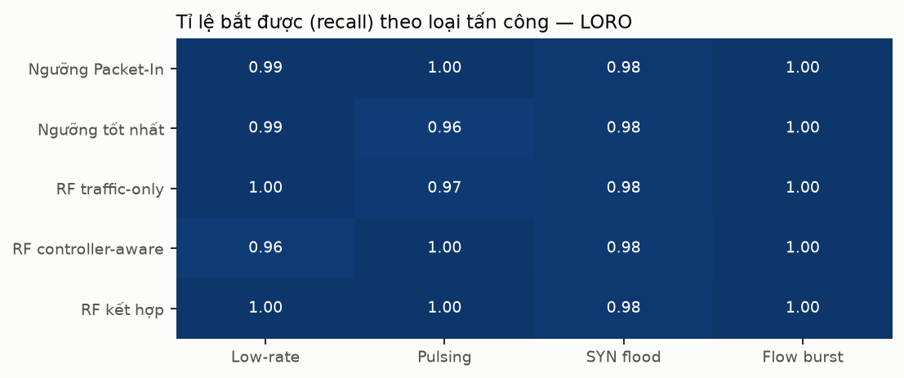
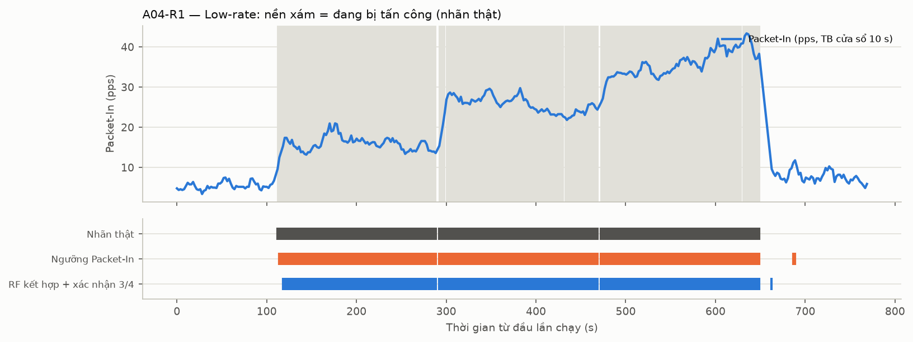
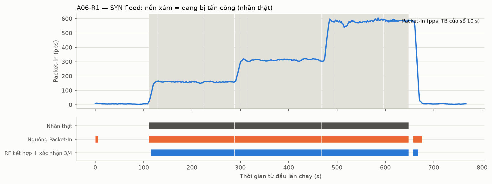
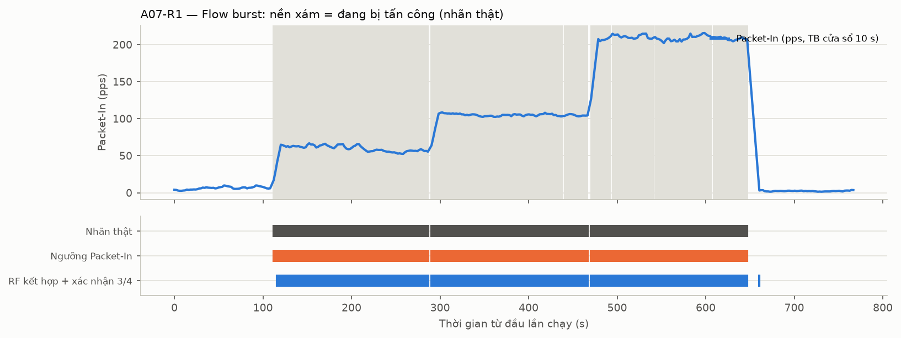
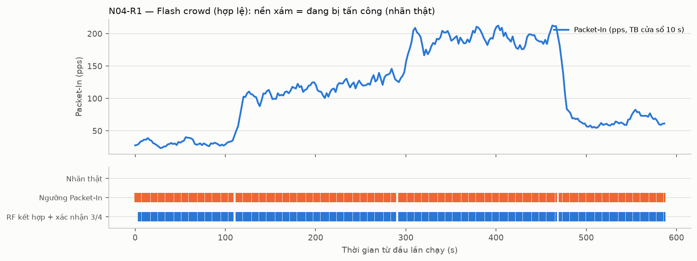

# Báo cáo thực nghiệm — Phát hiện tấn công bảo vệ SDN Controller (chương 4)

Sinh tự động bởi `src/evaluate.py` lúc 2026-11-22 18:37 UTC.

## 1. Thiết lập

- Dữ liệu: các kịch bản mới (lưu lượng nền luôn chạy, reactive mô phỏng, có đặc trưng mặt phẳng dữ liệu): **8011 cửa sổ 10 s** từ **25 lần chạy** — số lần chạy/kịch bản: {'A04': 5, 'A05': 5, 'A06': 5, 'A07': 5, 'N04': 5}.
- Nhãn 0: 3564 cửa sổ, nhãn 1: 4447. Bỏ 324 cửa sổ trong **12 s ngay sau khi tấn công dừng** (dư chấn: SYN-ACK gửi lại, cửa sổ còn mẫu tấn công).
- **Kiểm định chéo leave-one-run-out (LORO):** mỗi lần chạy lần lượt làm tập kiểm thử, huấn luyện trên các lần chạy còn lại → đánh giá trên lần chạy *chưa từng thấy*, không rò rỉ giữa các cửa sổ chồng lấn.
- Bộ đặc trưng: traffic-only 10, controller-aware 20, kết hợp 30 (danh sách trong `data/processed/features.json`).
- Đường cơ sở: **Ngưỡng Packet-In** (`pin_mean`, chọn ngưỡng F1 tốt nhất trên tập huấn luyện mỗi fold) và **Ngưỡng tốt nhất** (thử mọi đặc trưng, mọi chiều, lấy cái tốt nhất trên tập huấn luyện — đường cơ sở mạnh).
- Random Forest: 300 cây, `min_samples_leaf=2`, `class_weight=balanced`, ngưỡng xác suất 0,5.

## 2. Kết quả chính (gộp mọi fold LORO, theo từng cửa sổ)

| Phương pháp | Precision | Recall | F1 | FPR | ROC-AUC | PR-AUC |
|---|---|---|---|---|---|---|
| Ngưỡng Packet-In | 0.748 | 0.991 | 0.853 | 0.417 | 0.995 | 0.997 |
| Ngưỡng tốt nhất | 0.992 | 0.985 | 0.989 | 0.010 | 0.992 | 0.996 |
| RF traffic-only | 0.995 | 0.988 | 0.992 | 0.006 | 0.995 | 0.997 |
| RF controller-aware | 0.976 | 0.981 | 0.978 | 0.030 | 0.998 | 0.999 |
| RF kết hợp | 0.998 | 0.993 | 0.995 | 0.002 | 0.998 | 0.999 |

Chênh lệch F1: RF kết hợp − đường cơ sở tốt nhất = **+0.007**.

## 3. Theo loại lưu lượng

| Phương pháp | Recall Low-rate | Recall Pulsing | Recall SYN flood | Recall Flow burst | FPR flash crowd |
|---|---|---|---|---|---|
| Ngưỡng Packet-In | 0.993 | 0.998 | 0.978 | 1.000 | 1.000 |
| Ngưỡng tốt nhất | 0.992 | 0.955 | 0.976 | 0.998 | 0.001 |
| RF traffic-only | 0.995 | 0.969 | 0.976 | 0.999 | 0.000 |
| RF controller-aware | 0.964 | 1.000 | 0.976 | 0.996 | 0.067 |
| RF kết hợp | 0.996 | 1.000 | 0.979 | 1.000 | 0.000 |

## 4. F1 theo từng lần chạy (lần chạy có cả hai lớp)

| Phương pháp | A04-R1 | A04-R2 | A04-R3 | A04-R4 | A04-R5 | A05-R1 | A05-R2 | A05-R3 | A05-R4 | A05-R5 | A06-R1 | A06-R2 | A06-R3 | A06-R4 | A06-R5 | A07-R1 | A07-R2 | A07-R3 | A07-R4 | A07-R5 | TB ± ĐLC |
|---|---|---|---|---|---|---|---|---|---|---|---|---|---|---|---|---|---|---|---|---|---|
| Ngưỡng Packet-In | 0.994 | 0.996 | 0.996 | 0.994 | 0.998 | 1.000 | 0.994 | 1.000 | 0.994 | 1.000 | 0.980 | 0.985 | 0.991 | 0.979 | 0.965 | 1.000 | 0.998 | 1.000 | 1.000 | 1.000 | 0.993 ± 0.009 |
| Ngưỡng tốt nhất | 0.996 | 0.994 | 0.998 | 0.996 | 0.996 | 0.960 | 0.965 | 0.977 | 0.978 | 0.989 | 0.987 | 0.989 | 0.989 | 0.964 | 0.956 | 1.000 | 0.998 | 0.996 | 0.998 | 1.000 | 0.986 ± 0.014 |
| RF traffic-only | 0.998 | 0.994 | 1.000 | 0.998 | 0.998 | 0.960 | 0.977 | 0.989 | 0.989 | 0.989 | 0.987 | 0.989 | 0.991 | 0.975 | 0.963 | 1.000 | 0.998 | 0.998 | 1.000 | 1.000 | 0.990 ± 0.012 |
| RF controller-aware | 0.994 | 0.967 | 0.989 | 0.994 | 0.957 | 1.000 | 1.000 | 1.000 | 1.000 | 1.000 | 0.994 | 0.998 | 1.000 | 0.979 | 0.959 | 0.996 | 1.000 | 0.991 | 1.000 | 1.000 | 0.991 ± 0.014 |
| RF kết hợp | 0.998 | 0.998 | 0.998 | 0.998 | 0.998 | 0.994 | 0.994 | 1.000 | 1.000 | 1.000 | 0.993 | 0.998 | 1.000 | 0.981 | 0.965 | 1.000 | 1.000 | 1.000 | 1.000 | 1.000 | 0.996 ± 0.008 |

## 5. Xác nhận nhiều cửa sổ (3/4) — chống báo động nhấp nháy (mục 2.6.1)

Báo động khi ≥ 3 trong 4 cửa sổ gần nhất (cửa sổ trượt 2 s) bị phân loại là tấn công. Độ trễ tính từ cửa sổ đầu tiên của đợt tấn công tới khi báo động.

| Phương pháp | F1 sau xác nhận | FPR sau xác nhận | Đợt tấn công | Bỏ sót đợt | Độ trễ TB (s) | Độ trễ P90 (s) | Báo động giả / giờ |
|---|---|---|---|---|---|---|---|
| Ngưỡng Packet-In | 0.83 | 0.43 | 65 | 0 | 4.33 | 4.05 | 2.53 |
| Ngưỡng tốt nhất | 0.97 | 0.02 | 65 | 0 | 5.14 | 6.07 | 1.01 |
| RF traffic-only | 0.97 | 0.02 | 65 | 0 | 4.71 | 6.04 | 0.00 |
| RF controller-aware | 0.96 | 0.03 | 65 | 0 | 4.21 | 4.05 | 8.59 |
| RF kết hợp | 0.97 | 0.02 | 65 | 0 | 4.18 | 4.05 | 0.00 |

## 6. Độ quan trọng đặc trưng (RF kết hợp, toàn bộ dữ liệu)

| Đặc trưng | Importance |
|---|---|
| `dp_reply_mean` | 0.2863 |
| `dp_ppf_mean` | 0.1787 |
| `dp_flows_max` | 0.1057 |
| `dp_flows_mean` | 0.0745 |
| `pin_mean` | 0.0474 |
| `pin_last` | 0.0407 |
| `dp_dport_h_mean` | 0.0371 |
| `pin_max` | 0.0356 |
| `dp_udp_frac_mean` | 0.0299 |
| `api_mean` | 0.0277 |
| `dp_size_mean` | 0.0253 |
| `api_last` | 0.0237 |
| `api_max` | 0.0178 |
| `cpu_mean` | 0.0139 |
| `pin_std` | 0.0125 |

## 7. Diễn biến theo thời gian (lần chạy R1)

## 8. Ngưỡng mà đường cơ sở chọn ở từng fold

- **Ngưỡng Packet-In**: A04-R1: `pin_mean` > 10.740; A04-R2: `pin_mean` > 11.210; A04-R3: `pin_mean` > 11.210; A04-R4: `pin_mean` > 11.210; A04-R5: `pin_mean` > 11.210; A05-R1: `pin_mean` > 11.210; A05-R2: `pin_mean` > 11.210; A05-R3: `pin_mean` > 11.210; A05-R4: `pin_mean` > 11.344; A05-R5: `pin_mean` > 11.210; A06-R1: `pin_mean` > 10.740; A06-R2: `pin_mean` > 11.210; A06-R3: `pin_mean` > 11.210; A06-R4: `pin_mean` > 11.210; A06-R5: `pin_mean` > 11.210; A07-R1: `pin_mean` > 11.210; A07-R2: `pin_mean` > 11.210; A07-R3: `pin_mean` > 11.210; A07-R4: `pin_mean` > 11.210; A07-R5: `pin_mean` > 11.210; N04-R1: `pin_mean` > 11.210; N04-R2: `pin_mean` > 11.210; N04-R3: `pin_mean` > 11.210; N04-R4: `pin_mean` > 11.210; N04-R5: `pin_mean` > 11.210
- **Ngưỡng tốt nhất**: A04-R1: `dp_reply_mean` < 0.964; A04-R2: `dp_reply_mean` < 0.964; A04-R3: `dp_reply_mean` < 0.964; A04-R4: `dp_reply_mean` < 0.964; A04-R5: `dp_reply_mean` < 0.964; A05-R1: `dp_reply_mean` < 0.964; A05-R2: `dp_reply_mean` < 0.964; A05-R3: `dp_reply_mean` < 0.964; A05-R4: `dp_reply_mean` < 0.958; A05-R5: `dp_reply_mean` < 0.964; A06-R1: `dp_reply_mean` < 0.964; A06-R2: `dp_reply_mean` < 0.964; A06-R3: `dp_reply_mean` < 0.964; A06-R4: `dp_reply_mean` < 0.964; A06-R5: `dp_reply_mean` < 0.965; A07-R1: `dp_reply_mean` < 0.964; A07-R2: `dp_reply_mean` < 0.964; A07-R3: `dp_reply_mean` < 0.964; A07-R4: `dp_reply_mean` < 0.964; A07-R5: `dp_reply_mean` < 0.964; N04-R1: `dp_reply_mean` < 0.964; N04-R2: `dp_reply_mean` < 0.964; N04-R3: `dp_reply_mean` < 0.964; N04-R4: `dp_reply_mean` < 0.964; N04-R5: `dp_reply_mean` < 0.964

## 9. Mô hình xuất cho module phát hiện thời gian thực

`models/detector_rf.joblib` — RF kết hợp huấn luyện trên toàn bộ 25 lần chạy, 30 đặc trưng, xác nhận 3/4. Suy luận ~59.53 ms/cửa sổ.

## 10. Tổng quát hóa khi tráo vai máy (train R1–R3 → test R4–R5)

R1–R3: tấn công phát từ vm-attacker (.13), flash crowd/người dùng từ vm-client (.11). R4–R5 **đảo vai**: tấn công từ .11, flash crowd từ .13. Huấn luyện chỉ trên R1–R3 (4806 cửa sổ), kiểm thử trên R4–R5 (3205 cửa sổ) — mô hình chưa từng thấy tấn công đến từ .11. Dòng cuối cố ý thêm lại `dp_src_mean` (số máy nguồn — phản ánh danh tính, đã loại khỏi mô hình) để đo cái giá của việc học danh tính.

| Phương pháp (train R1–R3 → test R4–R5) | Precision | Recall | F1 | FPR | Recall Low-rate | Recall Pulsing | Recall SYN flood | Recall Flow burst | FPR flash crowd |
|---|---|---|---|---|---|---|---|---|---|
| Ngưỡng Packet-In | 0.750 | 0.981 | 0.850 | 0.409 | 0.992 | 0.994 | 0.946 | 1.000 | 1.000 |
| Ngưỡng tốt nhất | 0.992 | 0.979 | 0.985 | 0.010 | 0.992 | 0.983 | 0.944 | 0.998 | 0.002 |
| RF traffic-only | 0.996 | 0.974 | 0.985 | 0.005 | 0.996 | 0.983 | 0.923 | 1.000 | 0.000 |
| RF controller-aware | 0.981 | 0.963 | 0.972 | 0.024 | 0.964 | 1.000 | 0.912 | 1.000 | 0.058 |
| RF kết hợp | 1.000 | 0.973 | 0.986 | 0.000 | 0.994 | 1.000 | 0.916 | 1.000 | 0.000 |
| RF kết hợp + dp_src_mean (danh tính) | 0.998 | 0.969 | 0.983 | 0.002 | 0.992 | 1.000 | 0.904 | 1.000 | 0.005 |

## 11. Ghi chú trung thực

- LORO có thể để một fold thiếu hẳn một loại lưu lượng trong tập huấn luyện (ví dụ bỏ N04 ra làm test thì mô hình chưa từng thấy flash crowd) — đây là kiểm thử tổng quát hóa khắt khe, không phải lỗi.
- Đặc trưng theo cổng/máy (`rxpps_<port>`) KHÔNG được dùng (tránh học thuộc danh tính máy).
- Flow-Mod luôn = 0 (switch tự học flow trong chế độ reactive mô phỏng) → `fmod_*` không mang thông tin.