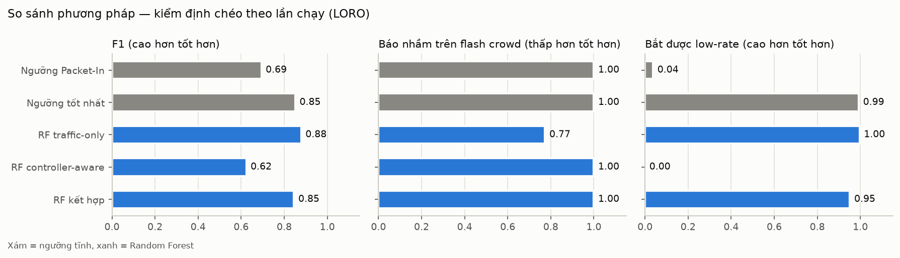

# Báo cáo thực nghiệm — Phát hiện tấn công bảo vệ SDN Controller (chương 4)

Sinh tự động bởi `src/evaluate.py` lúc 2026-11-22 05:23 UTC.

## 1. Thiết lập

- Dữ liệu: các kịch bản mới (lưu lượng nền luôn chạy, reactive mô phỏng, có đặc trưng mặt phẳng dữ liệu): **1601 cửa sổ 10 s** từ **5 lần chạy** — số lần chạy/kịch bản: {'A04': 1, 'A05': 1, 'A06': 1, 'A07': 1, 'N04': 1}.
- Nhãn 0: 713 cửa sổ, nhãn 1: 888. Bỏ 64 cửa sổ trong **12 s ngay sau khi tấn công dừng** (dư chấn: SYN-ACK gửi lại, cửa sổ còn mẫu tấn công).
- **Kiểm định chéo leave-one-run-out (LORO):** mỗi lần chạy lần lượt làm tập kiểm thử, huấn luyện trên các lần chạy còn lại → đánh giá trên lần chạy *chưa từng thấy*, không rò rỉ giữa các cửa sổ chồng lấn.
- Bộ đặc trưng: traffic-only 11, controller-aware 20, kết hợp 31 (danh sách trong `data/processed/features.json`).
- Đường cơ sở: **Ngưỡng Packet-In** (`pin_mean`, chọn ngưỡng F1 tốt nhất trên tập huấn luyện mỗi fold) và **Ngưỡng tốt nhất** (thử mọi đặc trưng, mọi chiều, lấy cái tốt nhất trên tập huấn luyện — đường cơ sở mạnh).
- Random Forest: 300 cây, `min_samples_leaf=2`, `class_weight=balanced`, ngưỡng xác suất 0,5.

## 2. Kết quả chính (gộp mọi fold LORO, theo từng cửa sổ)

| Phương pháp | Precision | Recall | F1 | FPR | ROC-AUC | PR-AUC |
|---|---|---|---|---|---|---|
| Ngưỡng Packet-In | 0.678 | 0.711 | 0.694 | 0.421 | 0.993 | 0.995 |
| Ngưỡng tốt nhất | 0.746 | 0.991 | 0.851 | 0.421 | 0.989 | 0.991 |
| RF traffic-only | 0.790 | 0.990 | 0.879 | 0.328 | 0.992 | 0.994 |
| RF controller-aware | 0.644 | 0.605 | 0.624 | 0.417 | 0.989 | 0.993 |
| RF kết hợp | 0.744 | 0.977 | 0.845 | 0.418 | 0.999 | 0.999 |

Chênh lệch F1: RF kết hợp − đường cơ sở tốt nhất = **-0.006**.

## 3. Theo loại lưu lượng

| Phương pháp | Recall Low-rate | Recall Pulsing | Recall SYN flood | Recall Flow burst | FPR flash crowd |
|---|---|---|---|---|---|
| Ngưỡng Packet-In | 0.037 | 1.000 | 1.000 | 1.000 | 1.000 |
| Ngưỡng tốt nhất | 0.993 | 0.933 | 1.000 | 1.000 | 1.000 |
| RF traffic-only | 0.996 | 0.910 | 1.000 | 1.000 | 0.773 |
| RF controller-aware | 0.000 | 0.910 | 0.797 | 0.917 | 1.000 |
| RF kết hợp | 0.951 | 0.921 | 1.000 | 1.000 | 1.000 |

## 4. F1 theo từng lần chạy (lần chạy có cả hai lớp)

| Phương pháp | A04-R1 | A05-R1 | A06-R1 | A07-R1 | TB ± ĐLC |
|---|---|---|---|---|---|
| Ngưỡng Packet-In | 0.072 | 1.000 | 0.983 | 1.000 | 0.764 ± 0.399 |
| Ngưỡng tốt nhất | 0.996 | 0.960 | 0.985 | 1.000 | 0.985 ± 0.016 |
| RF traffic-only | 0.998 | 0.953 | 0.983 | 1.000 | 0.984 ± 0.019 |
| RF controller-aware | 0.000 | 0.953 | 0.876 | 0.957 | 0.696 ± 0.403 |
| RF kết hợp | 0.975 | 0.959 | 0.987 | 1.000 | 0.980 ± 0.015 |

## 5. Xác nhận nhiều cửa sổ (3/4) — chống báo động nhấp nháy (mục 2.6.1)

Báo động khi ≥ 3 trong 4 cửa sổ gần nhất (cửa sổ trượt 2 s) bị phân loại là tấn công. Độ trễ tính từ cửa sổ đầu tiên của đợt tấn công tới khi báo động.

| Phương pháp | F1 sau xác nhận | FPR sau xác nhận | Đợt tấn công | Bỏ sót đợt | Độ trễ TB (s) | Độ trễ P90 (s) | Báo động giả / giờ |
|---|---|---|---|---|---|---|---|
| Ngưỡng Packet-In | 0.67 | 0.43 | 13 | 0 | 43.76 | 4.05 | 2.52 |
| Ngưỡng tốt nhất | 0.83 | 0.43 | 13 | 0 | 5.27 | 6.07 | 2.52 |
| RF traffic-only | 0.86 | 0.33 | 13 | 0 | 5.42 | 6.06 | 35.34 |
| RF controller-aware | 0.59 | 0.43 | 13 | 1 | 4.03 | 4.04 | 2.52 |
| RF kết hợp | 0.83 | 0.43 | 13 | 0 | 5.89 | 6.07 | 2.52 |

## 6. Độ quan trọng đặc trưng (RF kết hợp, toàn bộ dữ liệu)

| Đặc trưng | Importance |
|---|---|
| `dp_reply_mean` | 0.2788 |
| `dp_src_mean` | 0.1936 |
| `dp_ppf_mean` | 0.1394 |
| `dp_flows_max` | 0.0669 |
| `pin_mean` | 0.0506 |
| `dp_flows_mean` | 0.0489 |
| `pin_max` | 0.0287 |
| `dp_dport_h_mean` | 0.0286 |
| `pin_last` | 0.0284 |
| `dp_udp_frac_mean` | 0.0191 |
| `dp_size_mean` | 0.0152 |
| `api_mean` | 0.0144 |
| `pin_min` | 0.0135 |
| `pin_std` | 0.0130 |
| `api_last` | 0.0092 |

## 7. Diễn biến theo thời gian (lần chạy R1)

## 8. Ngưỡng mà đường cơ sở chọn ở từng fold

- **Ngưỡng Packet-In**: A04-R1: `pin_mean` > 40.377; A05-R1: `pin_mean` > 12.140; A06-R1: `pin_mean` > 12.140; A07-R1: `pin_mean` > 12.140; N04-R1: `pin_mean` > 12.140
- **Ngưỡng tốt nhất**: A04-R1: `dp_reply_mean` < 0.962; A05-R1: `dp_reply_mean` < 0.960; A06-R1: `dp_reply_mean` < 0.966; A07-R1: `dp_reply_mean` < 0.962; N04-R1: `pin_mean` > 12.140

## 9. Mô hình xuất cho module phát hiện thời gian thực

`models/detector_rf.joblib` — RF kết hợp huấn luyện trên toàn bộ 5 lần chạy, 31 đặc trưng, xác nhận 3/4. Suy luận ~106.29 ms/cửa sổ.

## 10. Ghi chú trung thực

- Kết quả sẽ ổn định hơn khi đủ 5 lần chạy/kịch bản (R4–R5 tráo vai máy nguồn). Với ít lần chạy, một fold LORO có thể thiếu hẳn một loại lưu lượng trong tập huấn luyện (ví dụ bỏ N04 ra làm test thì mô hình chưa từng thấy flash crowd) — đây là kiểm thử tổng quát hóa khắt khe, không phải lỗi.
- Đặc trưng theo cổng/máy (`rxpps_<port>`) KHÔNG được dùng (tránh học thuộc danh tính máy).
- Flow-Mod luôn = 0 (switch tự học flow trong chế độ reactive mô phỏng) → `fmod_*` không mang thông tin.