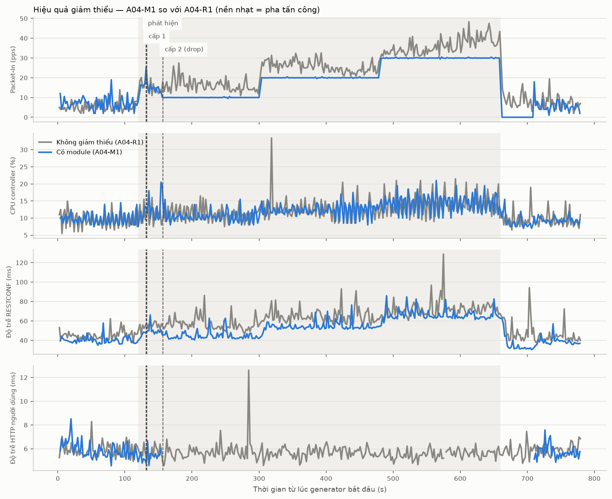

# Hiệu quả giảm thiểu — A04-M1 so với A04-R1

Sinh bởi `src/analyze_mitigation.py`. Cùng kịch bản A04, lưu lượng nền như nhau; A04-R1 chạy không có module, A04-M1 chạy có module thời gian thực.

## Dòng thời gian của module (tính từ lúc tấn công bắt đầu)

| Mốc | Giây sau khi tấn công bắt đầu |
|---|---|
| Nghi ngờ (cửa sổ đầu dương tính) | 7.6 |
| Xác nhận tấn công (k/n) | 11.6 |
| Cài rule cấp 1 xong (RESTCONF) | 12.7 |
| Rule cấp 1 nằm trên switch | 12.7 |
| Cài rule cấp 2 (drop) | 36.7 |

Rule cấp 1: RESTCONF 13.1 ms, lên switch sau 1.01 s.

## So sánh theo pha (trung bình)

| Pha | Chỉ số | Không giảm thiểu | Có module | Thay đổi |
|---|---|---|---|---|
| baseline | Packet-In (pps) | 5.48 | 7.00 | +28% |
| baseline | CPU controller (%) | 9.45 | 9.62 | +2% |
| baseline | Độ trễ RESTCONF (ms) | 45.11 | 40.09 | -11% |
| baseline | Độ trễ HTTP người dùng (ms) | 5.90 | 5.88 | -0% |
| baseline | HTTP thành công | 1.00 | 1.00 | +0% |
| P1 | Packet-In (pps) | 16.00 | 10.99 | -31% |
| P1 | CPU controller (%) | 11.16 | 10.86 | -3% |
| P1 | Độ trễ RESTCONF (ms) | 56.51 | 45.63 | -19% |
| P1 | Độ trễ HTTP người dùng (ms) | 5.75 | 5.39 | -6% |
| P1 | HTTP thành công | 1.00 | 0.25 | -75% |
| P2 | Packet-In (pps) | 25.68 | 20.00 | -22% |
| P2 | CPU controller (%) | 12.79 | 12.31 | -4% |
| P2 | Độ trễ RESTCONF (ms) | 64.69 | 54.39 | -16% |
| P2 | Độ trễ HTTP người dùng (ms) | 5.68 | — | — |
| P2 | HTTP thành công | 1.00 | 0.00 | -100% |
| P3 | Packet-In (pps) | 36.29 | 30.00 | -17% |
| P3 | CPU controller (%) | 14.21 | 14.40 | +1% |
| P3 | Độ trễ RESTCONF (ms) | 72.35 | 66.27 | -8% |
| P3 | Độ trễ HTTP người dùng (ms) | 5.54 | — | — |
| P3 | HTTP thành công | 1.00 | 0.00 | -100% |
| recovery | Packet-In (pps) | 7.90 | 3.34 | -58% |
| recovery | CPU controller (%) | 9.62 | 9.16 | -5% |
| recovery | Độ trễ RESTCONF (ms) | 46.15 | 37.54 | -19% |
| recovery | Độ trễ HTTP người dùng (ms) | 5.88 | 5.73 | -3% |
| recovery | HTTP thành công | 1.00 | 0.69 | -31% |

