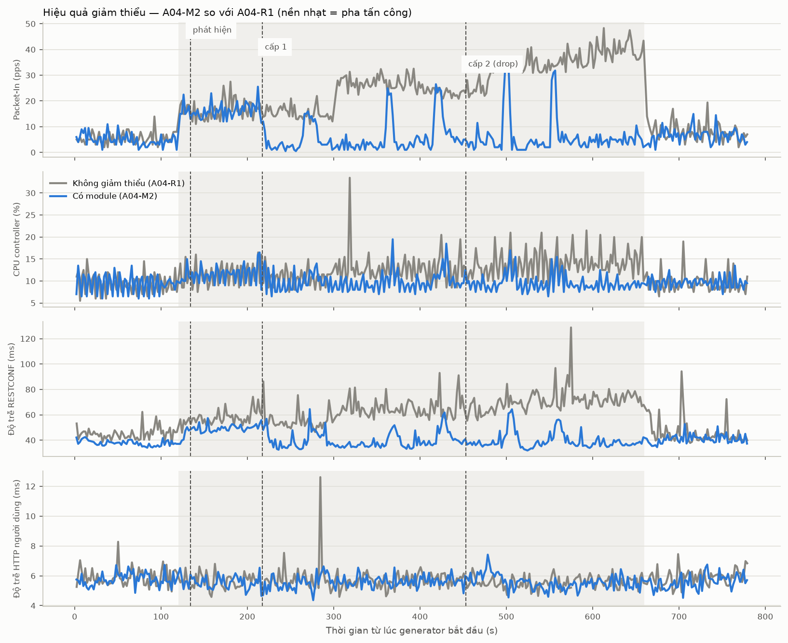

# Hiệu quả giảm thiểu — A04-M2 so với A04-R1

Sinh bởi `src/analyze_mitigation.py`. Cùng kịch bản A04, lưu lượng nền như nhau; A04-R1 chạy không có module, A04-M2 chạy có module thời gian thực.

## Dòng thời gian của module (tính từ lúc tấn công bắt đầu)

| Mốc | Giây sau khi tấn công bắt đầu |
|---|---|
| Nghi ngờ (cửa sổ đầu dương tính) | 10.0 |
| Xác nhận tấn công (k/n) | 14.0 |
| Cài rule cấp 1 xong (RESTCONF) | 97.6 |
| Rule cấp 1 nằm trên switch | 97.6 |
| Cài rule cấp 2 (drop) | 333.2 |

Rule cấp 1: RESTCONF 29.1 ms, lên switch sau 3.54 s.

## So sánh theo pha (trung bình)

| Pha | Chỉ số | Không giảm thiểu | Có module | Thay đổi |
|---|---|---|---|---|
| baseline | Packet-In (pps) | 5.48 | 4.85 | -11% |
| baseline | CPU controller (%) | 9.45 | 9.40 | -1% |
| baseline | Độ trễ RESTCONF (ms) | 45.11 | 37.76 | -16% |
| baseline | Độ trễ HTTP người dùng (ms) | 5.90 | 5.76 | -2% |
| baseline | HTTP thành công | 1.00 | 1.00 | +0% |
| P1 | Packet-In (pps) | 16.00 | 11.12 | -31% |
| P1 | CPU controller (%) | 11.16 | 10.75 | -4% |
| P1 | Độ trễ RESTCONF (ms) | 56.51 | 45.09 | -20% |
| P1 | Độ trễ HTTP người dùng (ms) | 5.75 | 5.54 | -4% |
| P1 | HTTP thành công | 1.00 | 1.00 | +0% |
| P2 | Packet-In (pps) | 25.68 | 5.74 | -78% |
| P2 | CPU controller (%) | 12.79 | 9.77 | -24% |
| P2 | Độ trễ RESTCONF (ms) | 64.69 | 39.03 | -40% |
| P2 | Độ trễ HTTP người dùng (ms) | 5.68 | 5.69 | +0% |
| P2 | HTTP thành công | 1.00 | 1.00 | +0% |
| P3 | Packet-In (pps) | 36.29 | 6.21 | -83% |
| P3 | CPU controller (%) | 14.21 | 9.57 | -33% |
| P3 | Độ trễ RESTCONF (ms) | 72.35 | 39.85 | -45% |
| P3 | Độ trễ HTTP người dùng (ms) | 5.54 | 5.47 | -1% |
| P3 | HTTP thành công | 1.00 | 1.00 | +0% |
| recovery | Packet-In (pps) | 7.90 | 6.57 | -17% |
| recovery | CPU controller (%) | 9.62 | 9.64 | +0% |
| recovery | Độ trễ RESTCONF (ms) | 46.15 | 40.80 | -12% |
| recovery | Độ trễ HTTP người dùng (ms) | 5.88 | 5.59 | -5% |
| recovery | HTTP thành công | 1.00 | 1.00 | +0% |

