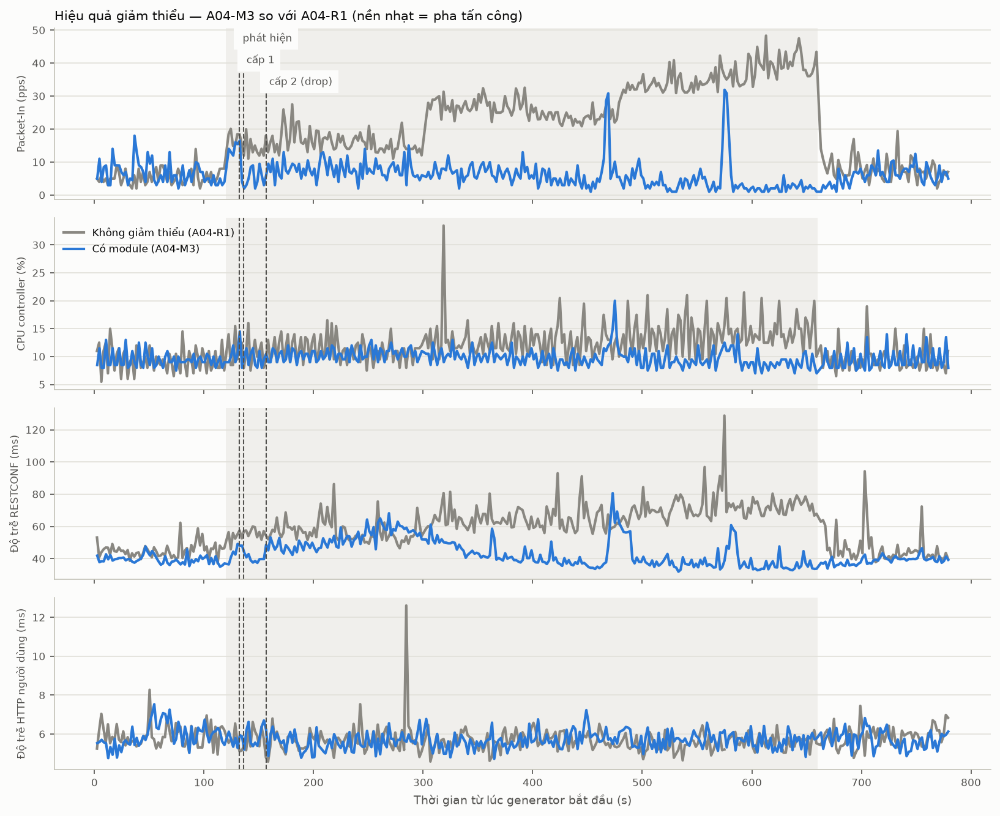

# Hiệu quả giảm thiểu — A04-M3 so với A04-R1

Sinh bởi `src/analyze_mitigation.py`. Cùng kịch bản A04, lưu lượng nền như nhau; A04-R1 chạy không có module, A04-M3 chạy có module thời gian thực.

## Dòng thời gian của module (tính từ lúc tấn công bắt đầu)

| Mốc | Giây sau khi tấn công bắt đầu |
|---|---|
| Nghi ngờ (cửa sổ đầu dương tính) | 8.4 |
| Xác nhận tấn công (k/n) | 12.5 |
| Cài rule cấp 1 xong (RESTCONF) | 16.0 |
| Rule cấp 1 nằm trên switch | 16.0 |
| Cài rule cấp 2 (drop) | 36.7 |

Rule cấp 1: RESTCONF 9.8 ms, lên switch sau 3.54 s.

## So sánh theo pha (trung bình)

| Pha | Chỉ số | Không giảm thiểu | Có module | Thay đổi |
|---|---|---|---|---|
| baseline | Packet-In (pps) | 5.48 | 6.63 | +21% |
| baseline | CPU controller (%) | 9.45 | 9.41 | -0% |
| baseline | Độ trễ RESTCONF (ms) | 45.11 | 39.46 | -13% |
| baseline | Độ trễ HTTP người dùng (ms) | 5.90 | 5.94 | +1% |
| baseline | HTTP thành công | 1.00 | 1.00 | +0% |
| P1 | Packet-In (pps) | 16.00 | 7.90 | -51% |
| P1 | CPU controller (%) | 11.16 | 10.32 | -8% |
| P1 | Độ trễ RESTCONF (ms) | 56.51 | 50.39 | -11% |
| P1 | Độ trễ HTTP người dùng (ms) | 5.75 | 5.64 | -2% |
| P1 | HTTP thành công | 1.00 | 1.00 | +0% |
| P2 | Packet-In (pps) | 25.68 | 6.62 | -74% |
| P2 | CPU controller (%) | 12.79 | 10.08 | -21% |
| P2 | Độ trễ RESTCONF (ms) | 64.69 | 43.57 | -33% |
| P2 | Độ trễ HTTP người dùng (ms) | 5.68 | 5.68 | +0% |
| P2 | HTTP thành công | 1.00 | 1.00 | +0% |
| P3 | Packet-In (pps) | 36.29 | 4.03 | -89% |
| P3 | CPU controller (%) | 14.21 | 9.30 | -35% |
| P3 | Độ trễ RESTCONF (ms) | 72.35 | 38.46 | -47% |
| P3 | Độ trễ HTTP người dùng (ms) | 5.54 | 5.69 | +3% |
| P3 | HTTP thành công | 1.00 | 1.00 | +0% |
| recovery | Packet-In (pps) | 7.90 | 5.93 | -25% |
| recovery | CPU controller (%) | 9.62 | 9.47 | -2% |
| recovery | Độ trễ RESTCONF (ms) | 46.15 | 38.91 | -16% |
| recovery | Độ trễ HTTP người dùng (ms) | 5.88 | 5.73 | -3% |
| recovery | HTTP thành công | 1.00 | 1.00 | +0% |

