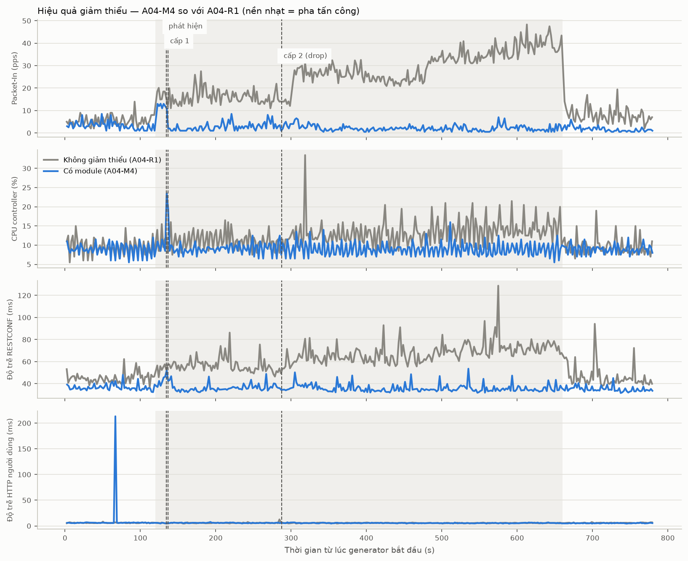

# Hiệu quả giảm thiểu — A04-M4 so với A04-R1

Sinh bởi `src/analyze_mitigation.py`. Cùng kịch bản A04, lưu lượng nền như nhau; A04-R1 chạy không có module, A04-M4 chạy có module thời gian thực.

## Dòng thời gian của module (tính từ lúc tấn công bắt đầu)

| Mốc | Giây sau khi tấn công bắt đầu |
|---|---|
| Nghi ngờ (cửa sổ đầu dương tính) | 10.7 |
| Xác nhận tấn công (k/n) | 14.7 |
| Cài rule cấp 1 xong (RESTCONF) | 16.7 |
| Rule cấp 1 nằm trên switch | 16.7 |
| Cài rule cấp 2 (drop) | 167.4 |

Rule cấp 1: RESTCONF 13.2 ms, lên switch sau 2.02 s.

## So sánh theo pha (trung bình)

| Pha | Chỉ số | Không giảm thiểu | Có module | Thay đổi |
|---|---|---|---|---|
| baseline | Packet-In (pps) | 5.48 | 3.23 | -41% |
| baseline | CPU controller (%) | 9.45 | 8.87 | -6% |
| baseline | Độ trễ RESTCONF (ms) | 45.11 | 36.59 | -19% |
| baseline | Độ trễ HTTP người dùng (ms) | 5.90 | 9.54 | +62% |
| baseline | HTTP thành công | 1.00 | 1.00 | +0% |
| P1 | Packet-In (pps) | 16.00 | 3.52 | -78% |
| P1 | CPU controller (%) | 11.16 | 9.38 | -16% |
| P1 | Độ trễ RESTCONF (ms) | 56.51 | 36.64 | -35% |
| P1 | Độ trễ HTTP người dùng (ms) | 5.75 | 5.84 | +2% |
| P1 | HTTP thành công | 1.00 | 1.00 | +0% |
| P2 | Packet-In (pps) | 25.68 | 2.15 | -92% |
| P2 | CPU controller (%) | 12.79 | 8.98 | -30% |
| P2 | Độ trễ RESTCONF (ms) | 64.69 | 35.95 | -44% |
| P2 | Độ trễ HTTP người dùng (ms) | 5.68 | 5.55 | -2% |
| P2 | HTTP thành công | 1.00 | 1.00 | +0% |
| P3 | Packet-In (pps) | 36.29 | 1.98 | -95% |
| P3 | CPU controller (%) | 14.21 | 8.91 | -37% |
| P3 | Độ trễ RESTCONF (ms) | 72.35 | 35.59 | -51% |
| P3 | Độ trễ HTTP người dùng (ms) | 5.54 | 5.49 | -1% |
| P3 | HTTP thành công | 1.00 | 1.00 | +0% |
| recovery | Packet-In (pps) | 7.90 | 1.64 | -79% |
| recovery | CPU controller (%) | 9.62 | 8.92 | -7% |
| recovery | Độ trễ RESTCONF (ms) | 46.15 | 35.02 | -24% |
| recovery | Độ trễ HTTP người dùng (ms) | 5.88 | 5.28 | -10% |
| recovery | HTTP thành công | 1.00 | 1.00 | +0% |

