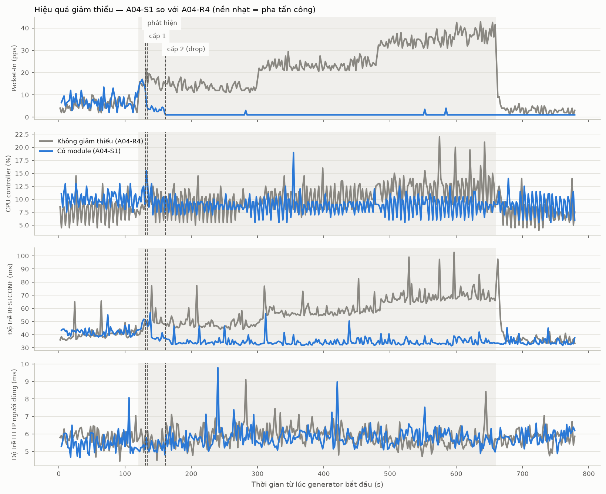

# Hiệu quả giảm thiểu — A04-S1 so với A04-R4

Sinh bởi `src/analyze_mitigation.py`. Cùng kịch bản A04, lưu lượng nền như nhau; A04-R4 chạy không có module, A04-S1 chạy có module thời gian thực.

## Dòng thời gian của module (tính từ lúc tấn công bắt đầu)

| Mốc | Giây sau khi tấn công bắt đầu |
|---|---|
| Nghi ngờ (cửa sổ đầu dương tính) | 6.9 |
| Xác nhận tấn công (k/n) | 10.9 |
| Cài rule cấp 1 xong (RESTCONF) | 13.5 |
| Rule cấp 1 nằm trên switch | 13.5 |
| Cài rule cấp 2 (drop) | 40.7 |

Rule cấp 1: RESTCONF 34.4 ms, lên switch sau 2.53 s.

## So sánh theo pha (trung bình)

| Pha | Chỉ số | Không giảm thiểu | Có module | Thay đổi |
|---|---|---|---|---|
| baseline | Packet-In (pps) | 5.66 | 6.76 | +19% |
| baseline | CPU controller (%) | 7.84 | 10.05 | +28% |
| baseline | Độ trễ RESTCONF (ms) | 40.57 | 41.91 | +3% |
| baseline | Độ trễ HTTP người dùng (ms) | 5.78 | 5.50 | -5% |
| baseline | HTTP thành công | 1.00 | 1.00 | +0% |
| P1 | Packet-In (pps) | 14.09 | 2.27 | -84% |
| P1 | CPU controller (%) | 8.98 | 9.06 | +1% |
| P1 | Độ trễ RESTCONF (ms) | 48.78 | 36.39 | -25% |
| P1 | Độ trễ HTTP người dùng (ms) | 5.88 | 5.71 | -3% |
| P1 | HTTP thành công | 1.00 | 1.00 | +0% |
| P2 | Packet-In (pps) | 23.30 | 1.00 | -96% |
| P2 | CPU controller (%) | 10.37 | 8.75 | -16% |
| P2 | Độ trễ RESTCONF (ms) | 57.81 | 34.41 | -40% |
| P2 | Độ trễ HTTP người dùng (ms) | 6.03 | 5.82 | -3% |
| P2 | HTTP thành công | 1.00 | 1.00 | +0% |
| P3 | Packet-In (pps) | 35.38 | 1.06 | -97% |
| P3 | CPU controller (%) | 12.27 | 8.77 | -29% |
| P3 | Độ trễ RESTCONF (ms) | 69.33 | 34.44 | -50% |
| P3 | Độ trễ HTTP người dùng (ms) | 5.62 | 5.78 | +3% |
| P3 | HTTP thành công | 1.00 | 1.00 | +0% |
| recovery | Packet-In (pps) | 3.21 | 1.00 | -69% |
| recovery | CPU controller (%) | 7.54 | 8.88 | +18% |
| recovery | Độ trễ RESTCONF (ms) | 37.92 | 34.43 | -9% |
| recovery | Độ trễ HTTP người dùng (ms) | 5.79 | 5.84 | +1% |
| recovery | HTTP thành công | 1.00 | 1.00 | +0% |

