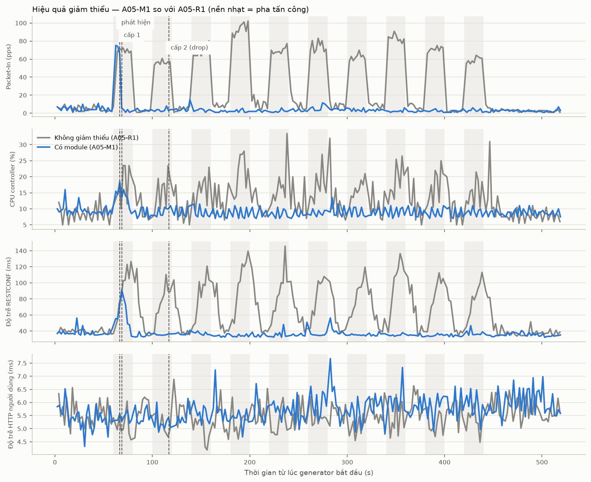

# Hiệu quả giảm thiểu — A05-M1 so với A05-R1

Sinh bởi `src/analyze_mitigation.py`. Cùng kịch bản A05, lưu lượng nền như nhau; A05-R1 chạy không có module, A05-M1 chạy có module thời gian thực.

## Dòng thời gian của module (tính từ lúc tấn công bắt đầu)

| Mốc | Giây sau khi tấn công bắt đầu |
|---|---|
| Nghi ngờ (cửa sổ đầu dương tính) | 2.3 |
| Xác nhận tấn công (k/n) | 6.4 |
| Cài rule cấp 1 xong (RESTCONF) | 8.9 |
| Rule cấp 1 nằm trên switch | 8.9 |
| Cài rule cấp 2 (drop) | 57.1 |

Rule cấp 1: RESTCONF 9.9 ms, lên switch sau 2.53 s.

## So sánh theo pha (trung bình)

| Pha | Chỉ số | Không giảm thiểu | Có module | Thay đổi |
|---|---|---|---|---|
| baseline | Packet-In (pps) | 5.06 | 4.74 | -7% |
| baseline | CPU controller (%) | 8.63 | 9.51 | +10% |
| baseline | Độ trễ RESTCONF (ms) | 39.55 | 37.90 | -4% |
| baseline | Độ trễ HTTP người dùng (ms) | 5.55 | 5.43 | -2% |
| baseline | HTTP thành công | 1.00 | 1.00 | +0% |
| on1 | Packet-In (pps) | 69.52 | 25.83 | -63% |
| on1 | CPU controller (%) | 17.98 | 13.76 | -23% |
| on1 | Độ trễ RESTCONF (ms) | 96.32 | 62.14 | -35% |
| on1 | Độ trễ HTTP người dùng (ms) | 5.14 | 5.42 | +5% |
| on1 | HTTP thành công | 1.00 | 1.00 | +0% |
| off1 | Packet-In (pps) | 2.23 | 3.33 | +50% |
| off1 | CPU controller (%) | 10.32 | 8.71 | -16% |
| off1 | Độ trễ RESTCONF (ms) | 61.27 | 35.12 | -43% |
| off1 | Độ trễ HTTP người dùng (ms) | 5.69 | 5.49 | -4% |
| off1 | HTTP thành công | 1.00 | 1.00 | +0% |
| on2 | Packet-In (pps) | 56.17 | 3.55 | -94% |
| on2 | CPU controller (%) | 15.48 | 9.27 | -40% |
| on2 | Độ trễ RESTCONF (ms) | 76.73 | 35.62 | -54% |
| on2 | Độ trễ HTTP người dùng (ms) | 5.13 | 5.23 | +2% |
| on2 | HTTP thành công | 1.00 | 1.00 | +0% |
| off2 | Packet-In (pps) | 4.51 | 5.10 | +13% |
| off2 | CPU controller (%) | 9.99 | 9.10 | -9% |
| off2 | Độ trễ RESTCONF (ms) | 53.66 | 36.94 | -31% |
| off2 | Độ trễ HTTP người dùng (ms) | 5.88 | 5.40 | -8% |
| off2 | HTTP thành công | 1.00 | 1.00 | +0% |
| on3 | Packet-In (pps) | 68.59 | 3.39 | -95% |
| on3 | CPU controller (%) | 16.04 | 8.83 | -45% |
| on3 | Độ trễ RESTCONF (ms) | 85.53 | 37.07 | -57% |
| on3 | Độ trễ HTTP người dùng (ms) | 4.96 | 5.58 | +12% |
| on3 | HTTP thành công | 1.00 | 1.00 | +0% |
| off3 | Packet-In (pps) | 9.01 | 1.78 | -80% |
| off3 | CPU controller (%) | 12.54 | 8.38 | -33% |
| off3 | Độ trễ RESTCONF (ms) | 61.51 | 34.31 | -44% |
| off3 | Độ trễ HTTP người dùng (ms) | 5.34 | 5.74 | +7% |
| off3 | HTTP thành công | 1.00 | 1.00 | +0% |
| on4 | Packet-In (pps) | 93.61 | 2.50 | -97% |
| on4 | CPU controller (%) | 20.54 | 8.66 | -58% |
| on4 | Độ trễ RESTCONF (ms) | 98.68 | 33.98 | -66% |
| on4 | Độ trễ HTTP người dùng (ms) | 5.27 | 5.39 | +2% |
| on4 | HTTP thành công | 1.00 | 1.00 | +0% |
| off4 | Packet-In (pps) | 10.47 | 2.44 | -77% |
| off4 | CPU controller (%) | 10.99 | 8.66 | -21% |
| off4 | Độ trễ RESTCONF (ms) | 64.26 | 34.92 | -46% |
| off4 | Độ trễ HTTP người dùng (ms) | 5.68 | 5.65 | -1% |
| off4 | HTTP thành công | 1.00 | 1.00 | +0% |
| on5 | Packet-In (pps) | 69.57 | 2.22 | -97% |
| on5 | CPU controller (%) | 17.21 | 8.49 | -51% |
| on5 | Độ trễ RESTCONF (ms) | 88.18 | 35.96 | -59% |
| on5 | Độ trễ HTTP người dùng (ms) | 5.23 | 5.74 | +10% |
| on5 | HTTP thành công | 1.00 | 1.00 | +0% |
| off5 | Packet-In (pps) | 10.13 | 3.11 | -69% |
| off5 | CPU controller (%) | 11.88 | 8.27 | -30% |
| off5 | Độ trễ RESTCONF (ms) | 62.68 | 36.80 | -41% |
| off5 | Độ trễ HTTP người dùng (ms) | 5.49 | 5.54 | +1% |
| off5 | HTTP thành công | 1.00 | 1.00 | +0% |
| on6 | Packet-In (pps) | 73.75 | 6.21 | -92% |
| on6 | CPU controller (%) | 16.99 | 8.77 | -48% |
| on6 | Độ trễ RESTCONF (ms) | 85.17 | 35.39 | -58% |
| on6 | Độ trễ HTTP người dùng (ms) | 5.46 | 5.96 | +9% |
| on6 | HTTP thành công | 1.00 | 1.00 | +0% |
| off6 | Packet-In (pps) | 8.04 | 4.33 | -46% |
| off6 | CPU controller (%) | 12.77 | 9.43 | -26% |
| off6 | Độ trễ RESTCONF (ms) | 59.06 | 40.32 | -32% |
| off6 | Độ trễ HTTP người dùng (ms) | 5.63 | 6.02 | +7% |
| off6 | HTTP thành công | 1.00 | 1.00 | +0% |
| on7 | Packet-In (pps) | 62.23 | 3.39 | -95% |
| on7 | CPU controller (%) | 15.87 | 8.94 | -44% |
| on7 | Độ trễ RESTCONF (ms) | 84.09 | 35.12 | -58% |
| on7 | Độ trễ HTTP người dùng (ms) | 5.06 | 5.56 | +10% |
| on7 | HTTP thành công | 1.00 | 1.00 | +0% |
| off7 | Packet-In (pps) | 8.62 | 3.55 | -59% |
| off7 | CPU controller (%) | 11.21 | 8.93 | -20% |
| off7 | Độ trễ RESTCONF (ms) | 59.65 | 36.03 | -40% |
| off7 | Độ trễ HTTP người dùng (ms) | 5.71 | 5.81 | +2% |
| off7 | HTTP thành công | 1.00 | 1.00 | +0% |
| on8 | Packet-In (pps) | 83.30 | 2.33 | -97% |
| on8 | CPU controller (%) | 18.48 | 8.94 | -52% |
| on8 | Độ trễ RESTCONF (ms) | 99.52 | 35.17 | -65% |
| on8 | Độ trễ HTTP người dùng (ms) | 5.37 | 6.13 | +14% |
| on8 | HTTP thành công | 1.00 | 1.00 | +0% |
| off8 | Packet-In (pps) | 6.86 | 2.00 | -71% |
| off8 | CPU controller (%) | 11.93 | 8.93 | -25% |
| off8 | Độ trễ RESTCONF (ms) | 64.95 | 34.54 | -47% |
| off8 | Độ trễ HTTP người dùng (ms) | 5.90 | 5.80 | -2% |
| off8 | HTTP thành công | 1.00 | 1.00 | +0% |
| on9 | Packet-In (pps) | 70.97 | 2.66 | -96% |
| on9 | CPU controller (%) | 16.99 | 8.66 | -49% |
| on9 | Độ trễ RESTCONF (ms) | 82.57 | 34.78 | -58% |
| on9 | Độ trễ HTTP người dùng (ms) | 5.19 | 5.83 | +12% |
| on9 | HTTP thành công | 1.00 | 1.00 | +0% |
| off9 | Packet-In (pps) | 2.23 | 2.22 | -0% |
| off9 | CPU controller (%) | 10.38 | 8.71 | -16% |
| off9 | Độ trễ RESTCONF (ms) | 55.52 | 34.30 | -38% |
| off9 | Độ trễ HTTP người dùng (ms) | 5.74 | 5.87 | +2% |
| off9 | HTTP thành công | 1.00 | 1.00 | +0% |
| on10 | Packet-In (pps) | 59.03 | 3.11 | -95% |
| on10 | CPU controller (%) | 14.99 | 8.99 | -40% |
| on10 | Độ trễ RESTCONF (ms) | 79.38 | 37.74 | -52% |
| on10 | Độ trễ HTTP người dùng (ms) | 5.30 | 5.88 | +11% |
| on10 | HTTP thành công | 1.00 | 1.00 | +0% |
| off10 | Packet-In (pps) | 4.39 | 2.55 | -42% |
| off10 | CPU controller (%) | 12.60 | 8.71 | -31% |
| off10 | Độ trễ RESTCONF (ms) | 58.16 | 34.40 | -41% |
| off10 | Độ trễ HTTP người dùng (ms) | 5.88 | 5.75 | -2% |
| off10 | HTTP thành công | 1.00 | 1.00 | +0% |
| recovery | Packet-In (pps) | 2.41 | 2.53 | +5% |
| recovery | CPU controller (%) | 7.84 | 8.77 | +12% |
| recovery | Độ trễ RESTCONF (ms) | 37.45 | 35.64 | -5% |
| recovery | Độ trễ HTTP người dùng (ms) | 5.70 | 6.04 | +6% |
| recovery | HTTP thành công | 1.00 | 1.00 | +0% |

