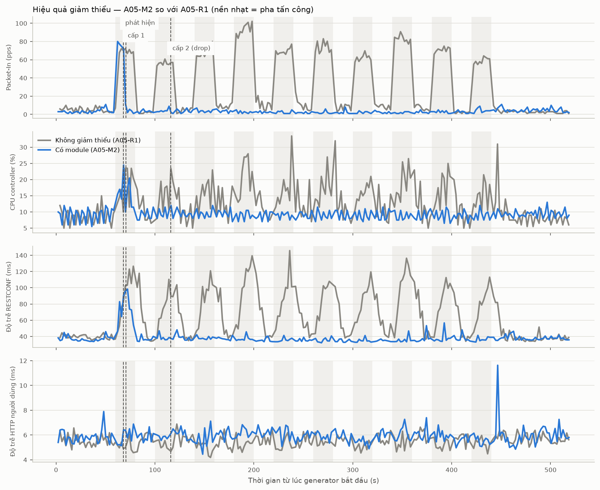

# Hiệu quả giảm thiểu — A05-M2 so với A05-R1

Sinh bởi `src/analyze_mitigation.py`. Cùng kịch bản A05, lưu lượng nền như nhau; A05-R1 chạy không có module, A05-M2 chạy có module thời gian thực.

## Dòng thời gian của module (tính từ lúc tấn công bắt đầu)

| Mốc | Giây sau khi tấn công bắt đầu |
|---|---|
| Nghi ngờ (cửa sổ đầu dương tính) | 4.1 |
| Xác nhận tấn công (k/n) | 8.1 |
| Cài rule cấp 1 xong (RESTCONF) | 10.7 |
| Rule cấp 1 nằm trên switch | 10.7 |
| Cài rule cấp 2 (drop) | 55.9 |

Rule cấp 1: RESTCONF 14.3 ms, lên switch sau 2.53 s.

## So sánh theo pha (trung bình)

| Pha | Chỉ số | Không giảm thiểu | Có module | Thay đổi |
|---|---|---|---|---|
| baseline | Packet-In (pps) | 5.06 | 3.31 | -35% |
| baseline | CPU controller (%) | 8.63 | 9.08 | +5% |
| baseline | Độ trễ RESTCONF (ms) | 39.55 | 37.05 | -6% |
| baseline | Độ trễ HTTP người dùng (ms) | 5.55 | 5.87 | +6% |
| baseline | HTTP thành công | 1.00 | 1.00 | +0% |
| on1 | Packet-In (pps) | 69.52 | 36.36 | -48% |
| on1 | CPU controller (%) | 17.98 | 15.76 | -12% |
| on1 | Độ trễ RESTCONF (ms) | 96.32 | 75.51 | -22% |
| on1 | Độ trễ HTTP người dùng (ms) | 5.14 | 5.89 | +15% |
| on1 | HTTP thành công | 1.00 | 1.00 | +0% |
| off1 | Packet-In (pps) | 2.23 | 3.22 | +45% |
| off1 | CPU controller (%) | 10.32 | 9.10 | -12% |
| off1 | Độ trễ RESTCONF (ms) | 61.27 | 36.71 | -40% |
| off1 | Độ trễ HTTP người dùng (ms) | 5.69 | 5.86 | +3% |
| off1 | HTTP thành công | 1.00 | 1.00 | +0% |
| on2 | Packet-In (pps) | 56.17 | 3.66 | -93% |
| on2 | CPU controller (%) | 15.48 | 9.60 | -38% |
| on2 | Độ trễ RESTCONF (ms) | 76.73 | 38.29 | -50% |
| on2 | Độ trễ HTTP người dùng (ms) | 5.13 | 5.94 | +16% |
| on2 | HTTP thành công | 1.00 | 1.00 | +0% |
| off2 | Packet-In (pps) | 4.51 | 3.77 | -16% |
| off2 | CPU controller (%) | 9.99 | 9.44 | -6% |
| off2 | Độ trễ RESTCONF (ms) | 53.66 | 38.56 | -28% |
| off2 | Độ trễ HTTP người dùng (ms) | 5.88 | 5.97 | +2% |
| off2 | HTTP thành công | 1.00 | 1.00 | +0% |
| on3 | Packet-In (pps) | 68.59 | 3.66 | -95% |
| on3 | CPU controller (%) | 16.04 | 9.49 | -41% |
| on3 | Độ trễ RESTCONF (ms) | 85.53 | 38.14 | -55% |
| on3 | Độ trễ HTTP người dùng (ms) | 4.96 | 5.70 | +15% |
| on3 | HTTP thành công | 1.00 | 1.00 | +0% |
| off3 | Packet-In (pps) | 9.01 | 3.66 | -59% |
| off3 | CPU controller (%) | 12.54 | 9.38 | -25% |
| off3 | Độ trễ RESTCONF (ms) | 61.51 | 37.47 | -39% |
| off3 | Độ trễ HTTP người dùng (ms) | 5.34 | 6.07 | +14% |
| off3 | HTTP thành công | 1.00 | 1.00 | +0% |
| on4 | Packet-In (pps) | 93.61 | 2.44 | -97% |
| on4 | CPU controller (%) | 20.54 | 8.99 | -56% |
| on4 | Độ trễ RESTCONF (ms) | 98.68 | 37.26 | -62% |
| on4 | Độ trễ HTTP người dùng (ms) | 5.27 | 6.21 | +18% |
| on4 | HTTP thành công | 1.00 | 1.00 | +0% |
| off4 | Packet-In (pps) | 10.47 | 2.44 | -77% |
| off4 | CPU controller (%) | 10.99 | 8.93 | -19% |
| off4 | Độ trễ RESTCONF (ms) | 64.26 | 35.63 | -45% |
| off4 | Độ trễ HTTP người dùng (ms) | 5.68 | 6.24 | +10% |
| off4 | HTTP thành công | 1.00 | 1.00 | +0% |
| on5 | Packet-In (pps) | 69.57 | 2.28 | -97% |
| on5 | CPU controller (%) | 17.21 | 8.99 | -48% |
| on5 | Độ trễ RESTCONF (ms) | 88.18 | 35.78 | -59% |
| on5 | Độ trễ HTTP người dùng (ms) | 5.23 | 6.14 | +18% |
| on5 | HTTP thành công | 1.00 | 1.00 | +0% |
| off5 | Packet-In (pps) | 10.13 | 1.78 | -82% |
| off5 | CPU controller (%) | 11.88 | 8.93 | -25% |
| off5 | Độ trễ RESTCONF (ms) | 62.68 | 35.46 | -43% |
| off5 | Độ trễ HTTP người dùng (ms) | 5.49 | 5.84 | +6% |
| off5 | HTTP thành công | 1.00 | 1.00 | +0% |
| on6 | Packet-In (pps) | 73.75 | 2.00 | -97% |
| on6 | CPU controller (%) | 16.99 | 8.93 | -47% |
| on6 | Độ trễ RESTCONF (ms) | 85.17 | 35.58 | -58% |
| on6 | Độ trễ HTTP người dùng (ms) | 5.46 | 5.91 | +8% |
| on6 | HTTP thành công | 1.00 | 1.00 | +0% |
| off6 | Packet-In (pps) | 8.04 | 2.22 | -72% |
| off6 | CPU controller (%) | 12.77 | 9.05 | -29% |
| off6 | Độ trễ RESTCONF (ms) | 59.06 | 34.63 | -41% |
| off6 | Độ trễ HTTP người dùng (ms) | 5.63 | 5.88 | +4% |
| off6 | HTTP thành công | 1.00 | 1.00 | +0% |
| on7 | Packet-In (pps) | 62.23 | 2.05 | -97% |
| on7 | CPU controller (%) | 15.87 | 8.93 | -44% |
| on7 | Độ trễ RESTCONF (ms) | 84.09 | 34.95 | -58% |
| on7 | Độ trễ HTTP người dùng (ms) | 5.06 | 5.43 | +7% |
| on7 | HTTP thành công | 1.00 | 1.00 | +0% |
| off7 | Packet-In (pps) | 8.62 | 2.28 | -74% |
| off7 | CPU controller (%) | 11.21 | 9.05 | -19% |
| off7 | Độ trễ RESTCONF (ms) | 59.65 | 34.84 | -42% |
| off7 | Độ trễ HTTP người dùng (ms) | 5.71 | 6.07 | +6% |
| off7 | HTTP thành công | 1.00 | 1.00 | +0% |
| on8 | Packet-In (pps) | 83.30 | 2.00 | -98% |
| on8 | CPU controller (%) | 18.48 | 8.77 | -53% |
| on8 | Độ trễ RESTCONF (ms) | 99.52 | 35.88 | -64% |
| on8 | Độ trễ HTTP người dùng (ms) | 5.37 | 6.09 | +13% |
| on8 | HTTP thành công | 1.00 | 1.00 | +0% |
| off8 | Packet-In (pps) | 6.86 | 2.33 | -66% |
| off8 | CPU controller (%) | 11.93 | 8.99 | -25% |
| off8 | Độ trễ RESTCONF (ms) | 64.95 | 37.56 | -42% |
| off8 | Độ trễ HTTP người dùng (ms) | 5.90 | 6.08 | +3% |
| off8 | HTTP thành công | 1.00 | 1.00 | +0% |
| on9 | Packet-In (pps) | 70.97 | 2.67 | -96% |
| on9 | CPU controller (%) | 16.99 | 8.88 | -48% |
| on9 | Độ trễ RESTCONF (ms) | 82.57 | 38.01 | -54% |
| on9 | Độ trễ HTTP người dùng (ms) | 5.19 | 5.99 | +16% |
| on9 | HTTP thành công | 1.00 | 1.00 | +0% |
| off9 | Packet-In (pps) | 2.23 | 2.50 | +12% |
| off9 | CPU controller (%) | 10.38 | 8.88 | -14% |
| off9 | Độ trễ RESTCONF (ms) | 55.52 | 37.88 | -32% |
| off9 | Độ trễ HTTP người dùng (ms) | 5.74 | 5.62 | -2% |
| off9 | HTTP thành công | 1.00 | 1.00 | +0% |
| on10 | Packet-In (pps) | 59.03 | 4.38 | -93% |
| on10 | CPU controller (%) | 14.99 | 8.94 | -40% |
| on10 | Độ trễ RESTCONF (ms) | 79.38 | 36.50 | -54% |
| on10 | Độ trễ HTTP người dùng (ms) | 5.30 | 5.55 | +5% |
| on10 | HTTP thành công | 1.00 | 1.00 | +0% |
| off10 | Packet-In (pps) | 4.39 | 5.77 | +31% |
| off10 | CPU controller (%) | 12.60 | 9.44 | -25% |
| off10 | Độ trễ RESTCONF (ms) | 58.16 | 38.50 | -34% |
| off10 | Độ trễ HTTP người dùng (ms) | 5.88 | 6.38 | +9% |
| off10 | HTTP thành công | 1.00 | 1.00 | +0% |
| recovery | Packet-In (pps) | 2.41 | 4.51 | +87% |
| recovery | CPU controller (%) | 7.84 | 9.46 | +21% |
| recovery | Độ trễ RESTCONF (ms) | 37.45 | 37.64 | +1% |
| recovery | Độ trễ HTTP người dùng (ms) | 5.70 | 5.93 | +4% |
| recovery | HTTP thành công | 1.00 | 1.00 | +0% |

