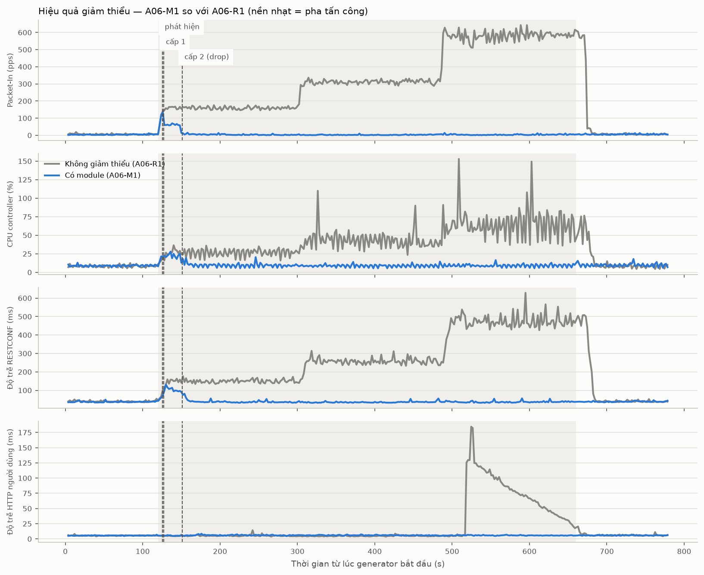

# Hiệu quả giảm thiểu — A06-M1 so với A06-R1

Sinh bởi `src/analyze_mitigation.py`. Cùng kịch bản A06, lưu lượng nền như nhau; A06-R1 chạy không có module, A06-M1 chạy có module thời gian thực.

## Dòng thời gian của module (tính từ lúc tấn công bắt đầu)

| Mốc | Giây sau khi tấn công bắt đầu |
|---|---|
| Nghi ngờ (cửa sổ đầu dương tính) | 1.7 |
| Xác nhận tấn công (k/n) | 5.7 |
| Cài rule cấp 1 xong (RESTCONF) | 7.2 |
| Rule cấp 1 nằm trên switch | 7.2 |
| Cài rule cấp 2 (drop) | 31.3 |

Rule cấp 1: RESTCONF 18.3 ms, lên switch sau 1.52 s.

## So sánh theo pha (trung bình)

| Pha | Chỉ số | Không giảm thiểu | Có module | Thay đổi |
|---|---|---|---|---|
| baseline | Packet-In (pps) | 6.35 | 3.96 | -38% |
| baseline | CPU controller (%) | 8.41 | 8.92 | +6% |
| baseline | Độ trễ RESTCONF (ms) | 40.67 | 37.42 | -8% |
| baseline | Độ trễ HTTP người dùng (ms) | 5.45 | 5.50 | +1% |
| baseline | HTTP thành công | 1.00 | 1.00 | +0% |
| P1 | Packet-In (pps) | 158.43 | 14.25 | -91% |
| P1 | CPU controller (%) | 26.43 | 11.57 | -56% |
| P1 | Độ trễ RESTCONF (ms) | 148.09 | 48.32 | -67% |
| P1 | Độ trễ HTTP người dùng (ms) | 5.25 | 5.95 | +13% |
| P1 | HTTP thành công | 1.00 | 1.00 | +0% |
| P2 | Packet-In (pps) | 309.74 | 2.49 | -99% |
| P2 | CPU controller (%) | 43.12 | 8.79 | -80% |
| P2 | Độ trễ RESTCONF (ms) | 254.42 | 35.57 | -86% |
| P2 | Độ trễ HTTP người dùng (ms) | 4.81 | 5.96 | +24% |
| P2 | HTTP thành công | 1.00 | 1.00 | +0% |
| P3 | Packet-In (pps) | 574.07 | 3.83 | -99% |
| P3 | CPU controller (%) | 64.31 | 9.14 | -86% |
| P3 | Độ trễ RESTCONF (ms) | 461.16 | 37.50 | -92% |
| P3 | Độ trễ HTTP người dùng (ms) | 62.23 | 5.72 | -91% |
| P3 | HTTP thành công | 1.00 | 1.00 | +0% |
| recovery | Packet-In (pps) | 64.31 | 5.82 | -91% |
| recovery | CPU controller (%) | 15.86 | 9.77 | -38% |
| recovery | Độ trễ RESTCONF (ms) | 104.80 | 38.78 | -63% |
| recovery | Độ trễ HTTP người dùng (ms) | 6.29 | 5.85 | -7% |
| recovery | HTTP thành công | 1.00 | 1.00 | +0% |

