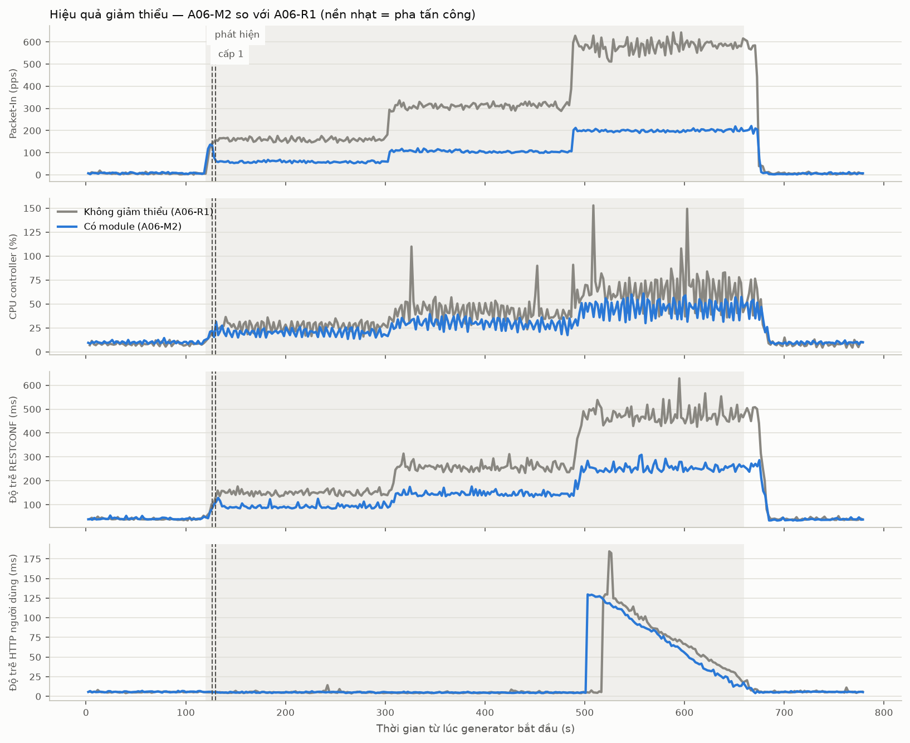

# Hiệu quả giảm thiểu — A06-M2 so với A06-R1

Sinh bởi `src/analyze_mitigation.py`. Cùng kịch bản A06, lưu lượng nền như nhau; A06-R1 chạy không có module, A06-M2 chạy có module thời gian thực.

## Dòng thời gian của module (tính từ lúc tấn công bắt đầu)

| Mốc | Giây sau khi tấn công bắt đầu |
|---|---|
| Nghi ngờ (cửa sổ đầu dương tính) | 2.2 |
| Xác nhận tấn công (k/n) | 6.3 |
| Cài rule cấp 1 xong (RESTCONF) | 9.8 |
| Rule cấp 1 nằm trên switch | 9.8 |

Rule cấp 1: RESTCONF 9.2 ms, lên switch sau 3.53 s.

## So sánh theo pha (trung bình)

| Pha | Chỉ số | Không giảm thiểu | Có module | Thay đổi |
|---|---|---|---|---|
| baseline | Packet-In (pps) | 6.35 | 7.53 | +19% |
| baseline | CPU controller (%) | 8.41 | 10.07 | +20% |
| baseline | Độ trễ RESTCONF (ms) | 40.67 | 41.95 | +3% |
| baseline | Độ trễ HTTP người dùng (ms) | 5.45 | 5.82 | +7% |
| baseline | HTTP thành công | 1.00 | 1.00 | +0% |
| P1 | Packet-In (pps) | 158.43 | 61.17 | -61% |
| P1 | CPU controller (%) | 26.43 | 20.33 | -23% |
| P1 | Độ trễ RESTCONF (ms) | 148.09 | 92.43 | -38% |
| P1 | Độ trễ HTTP người dùng (ms) | 5.25 | 5.15 | -2% |
| P1 | HTTP thành công | 1.00 | 1.00 | +0% |
| P2 | Packet-In (pps) | 309.74 | 105.31 | -66% |
| P2 | CPU controller (%) | 43.12 | 29.44 | -32% |
| P2 | Độ trễ RESTCONF (ms) | 254.42 | 144.47 | -43% |
| P2 | Độ trễ HTTP người dùng (ms) | 4.81 | 4.81 | -0% |
| P2 | HTTP thành công | 1.00 | 1.00 | +0% |
| P3 | Packet-In (pps) | 574.07 | 196.49 | -66% |
| P3 | CPU controller (%) | 64.31 | 44.60 | -31% |
| P3 | Độ trễ RESTCONF (ms) | 461.16 | 247.42 | -46% |
| P3 | Độ trễ HTTP người dùng (ms) | 62.23 | 63.61 | +2% |
| P3 | HTTP thành công | 1.00 | 1.00 | +0% |
| recovery | Packet-In (pps) | 64.31 | 26.93 | -58% |
| recovery | CPU controller (%) | 15.86 | 15.23 | -4% |
| recovery | Độ trễ RESTCONF (ms) | 104.80 | 72.28 | -31% |
| recovery | Độ trễ HTTP người dùng (ms) | 6.29 | 5.82 | -7% |
| recovery | HTTP thành công | 1.00 | 1.00 | +0% |

