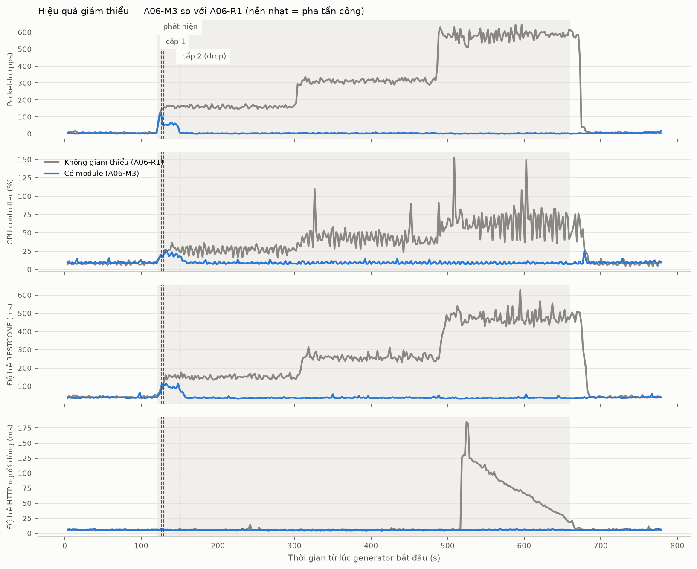

# Hiệu quả giảm thiểu — A06-M3 so với A06-R1

Sinh bởi `src/analyze_mitigation.py`. Cùng kịch bản A06, lưu lượng nền như nhau; A06-R1 chạy không có module, A06-M3 chạy có module thời gian thực.

## Dòng thời gian của module (tính từ lúc tấn công bắt đầu)

| Mốc | Giây sau khi tấn công bắt đầu |
|---|---|
| Nghi ngờ (cửa sổ đầu dương tính) | 1.8 |
| Xác nhận tấn công (k/n) | 5.8 |
| Cài rule cấp 1 xong (RESTCONF) | 9.4 |
| Rule cấp 1 nằm trên switch | 9.4 |
| Cài rule cấp 2 (drop) | 30.6 |

Rule cấp 1: RESTCONF 11.4 ms, lên switch sau 3.53 s.

## So sánh theo pha (trung bình)

| Pha | Chỉ số | Không giảm thiểu | Có module | Thay đổi |
|---|---|---|---|---|
| baseline | Packet-In (pps) | 6.35 | 3.28 | -48% |
| baseline | CPU controller (%) | 8.41 | 9.28 | +10% |
| baseline | Độ trễ RESTCONF (ms) | 40.67 | 37.70 | -7% |
| baseline | Độ trễ HTTP người dùng (ms) | 5.45 | 5.66 | +4% |
| baseline | HTTP thành công | 1.00 | 1.00 | +0% |
| P1 | Packet-In (pps) | 158.43 | 11.78 | -93% |
| P1 | CPU controller (%) | 26.43 | 10.89 | -59% |
| P1 | Độ trễ RESTCONF (ms) | 148.09 | 45.58 | -69% |
| P1 | Độ trễ HTTP người dùng (ms) | 5.25 | 5.40 | +3% |
| P1 | HTTP thành công | 1.00 | 1.00 | +0% |
| P2 | Packet-In (pps) | 309.74 | 3.36 | -99% |
| P2 | CPU controller (%) | 43.12 | 9.13 | -79% |
| P2 | Độ trễ RESTCONF (ms) | 254.42 | 36.09 | -86% |
| P2 | Độ trễ HTTP người dùng (ms) | 4.81 | 5.40 | +12% |
| P2 | HTTP thành công | 1.00 | 1.00 | +0% |
| P3 | Packet-In (pps) | 574.07 | 2.09 | -100% |
| P3 | CPU controller (%) | 64.31 | 8.75 | -86% |
| P3 | Độ trễ RESTCONF (ms) | 461.16 | 35.48 | -92% |
| P3 | Độ trễ HTTP người dùng (ms) | 62.23 | 5.60 | -91% |
| P3 | HTTP thành công | 1.00 | 1.00 | +0% |
| recovery | Packet-In (pps) | 64.31 | 4.94 | -92% |
| recovery | CPU controller (%) | 15.86 | 9.64 | -39% |
| recovery | Độ trễ RESTCONF (ms) | 104.80 | 38.19 | -64% |
| recovery | Độ trễ HTTP người dùng (ms) | 6.29 | 5.46 | -13% |
| recovery | HTTP thành công | 1.00 | 1.00 | +0% |

