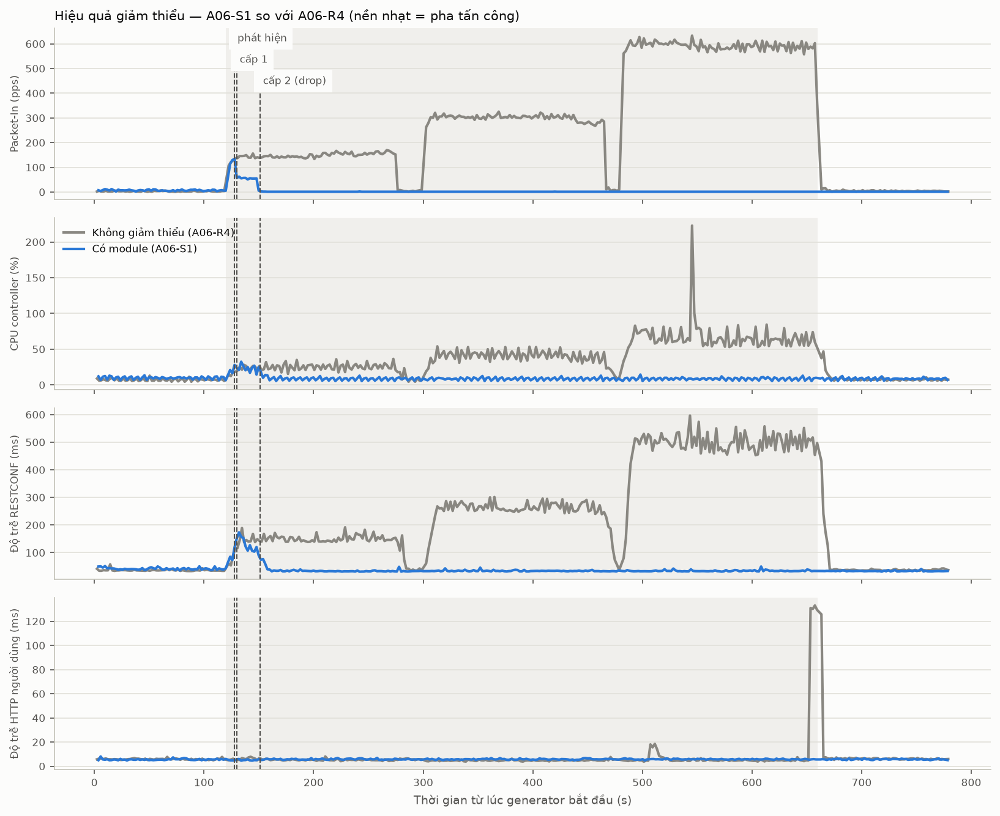

# Hiệu quả giảm thiểu — A06-S1 so với A06-R4

Sinh bởi `src/analyze_mitigation.py`. Cùng kịch bản A06, lưu lượng nền như nhau; A06-R4 chạy không có module, A06-S1 chạy có module thời gian thực.

## Dòng thời gian của module (tính từ lúc tấn công bắt đầu)

| Mốc | Giây sau khi tấn công bắt đầu |
|---|---|
| Nghi ngờ (cửa sổ đầu dương tính) | 3.7 |
| Xác nhận tấn công (k/n) | 7.8 |
| Cài rule cấp 1 xong (RESTCONF) | 9.8 |
| Rule cấp 1 nằm trên switch | 9.8 |
| Cài rule cấp 2 (drop) | 31.1 |

Rule cấp 1: RESTCONF 10.2 ms, lên switch sau 2.02 s.

## So sánh theo pha (trung bình)

| Pha | Chỉ số | Không giảm thiểu | Có module | Thay đổi |
|---|---|---|---|---|
| baseline | Packet-In (pps) | 2.99 | 6.78 | +127% |
| baseline | CPU controller (%) | 7.24 | 9.85 | +36% |
| baseline | Độ trễ RESTCONF (ms) | 36.39 | 41.82 | +15% |
| baseline | Độ trễ HTTP người dùng (ms) | 5.90 | 5.60 | -5% |
| baseline | HTTP thành công | 1.00 | 1.00 | +0% |
| P1 | Packet-In (pps) | 128.61 | 11.47 | -91% |
| P1 | CPU controller (%) | 22.82 | 11.07 | -52% |
| P1 | Độ trễ RESTCONF (ms) | 135.68 | 48.59 | -64% |
| P1 | Độ trễ HTTP người dùng (ms) | 5.50 | 5.68 | +3% |
| P1 | HTTP thành công | 1.00 | 1.00 | +0% |
| P2 | Packet-In (pps) | 277.13 | 1.00 | -100% |
| P2 | CPU controller (%) | 39.12 | 8.60 | -78% |
| P2 | Độ trễ RESTCONF (ms) | 247.86 | 34.05 | -86% |
| P2 | Độ trễ HTTP người dùng (ms) | 4.86 | 5.79 | +19% |
| P2 | HTTP thành công | 1.00 | 1.00 | +0% |
| P3 | Packet-In (pps) | 589.69 | 1.00 | -100% |
| P3 | CPU controller (%) | 66.45 | 8.64 | -87% |
| P3 | Độ trễ RESTCONF (ms) | 489.03 | 34.17 | -93% |
| P3 | Độ trễ HTTP người dùng (ms) | 11.18 | 5.79 | -48% |
| P3 | HTTP thành công | 1.00 | 1.00 | +0% |
| recovery | Packet-In (pps) | 4.61 | 1.00 | -78% |
| recovery | CPU controller (%) | 9.07 | 8.59 | -5% |
| recovery | Độ trễ RESTCONF (ms) | 51.25 | 33.63 | -34% |
| recovery | Độ trễ HTTP người dùng (ms) | 8.22 | 5.71 | -31% |
| recovery | HTTP thành công | 1.00 | 1.00 | +0% |

