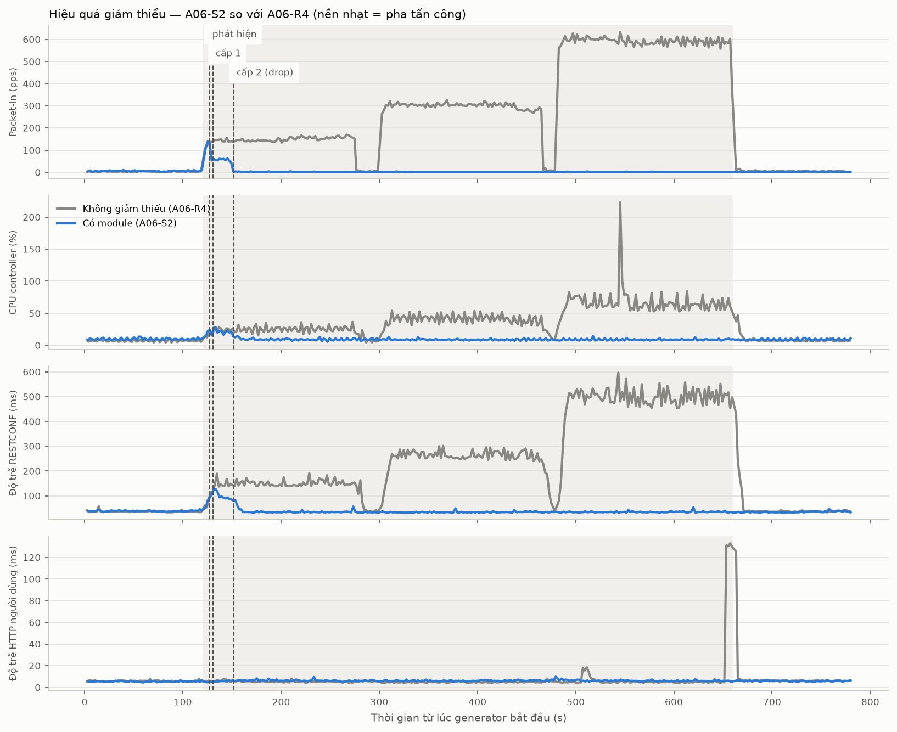

# Hiệu quả giảm thiểu — A06-S2 so với A06-R4

Sinh bởi `src/analyze_mitigation.py`. Cùng kịch bản A06, lưu lượng nền như nhau; A06-R4 chạy không có module, A06-S2 chạy có module thời gian thực.

## Dòng thời gian của module (tính từ lúc tấn công bắt đầu)

| Mốc | Giây sau khi tấn công bắt đầu |
|---|---|
| Nghi ngờ (cửa sổ đầu dương tính) | 3.1 |
| Xác nhận tấn công (k/n) | 7.2 |
| Cài rule cấp 1 xong (RESTCONF) | 10.7 |
| Rule cấp 1 nằm trên switch | 10.7 |
| Cài rule cấp 2 (drop) | 32.0 |

Rule cấp 1: RESTCONF 8.7 ms, lên switch sau 3.54 s.

## So sánh theo pha (trung bình)

| Pha | Chỉ số | Không giảm thiểu | Có module | Thay đổi |
|---|---|---|---|---|
| baseline | Packet-In (pps) | 2.99 | 5.10 | +71% |
| baseline | CPU controller (%) | 7.24 | 9.74 | +35% |
| baseline | Độ trễ RESTCONF (ms) | 36.39 | 38.54 | +6% |
| baseline | Độ trễ HTTP người dùng (ms) | 5.90 | 5.44 | -8% |
| baseline | HTTP thành công | 1.00 | 1.00 | +0% |
| P1 | Packet-In (pps) | 128.61 | 12.19 | -91% |
| P1 | CPU controller (%) | 22.82 | 11.17 | -51% |
| P1 | Độ trễ RESTCONF (ms) | 135.68 | 45.69 | -66% |
| P1 | Độ trễ HTTP người dùng (ms) | 5.50 | 6.15 | +12% |
| P1 | HTTP thành công | 1.00 | 1.00 | +0% |
| P2 | Packet-In (pps) | 277.13 | 1.03 | -100% |
| P2 | CPU controller (%) | 39.12 | 8.84 | -77% |
| P2 | Độ trễ RESTCONF (ms) | 247.86 | 34.11 | -86% |
| P2 | Độ trễ HTTP người dùng (ms) | 4.86 | 6.18 | +27% |
| P2 | HTTP thành công | 1.00 | 1.00 | +0% |
| P3 | Packet-In (pps) | 589.69 | 1.09 | -100% |
| P3 | CPU controller (%) | 66.45 | 8.88 | -87% |
| P3 | Độ trễ RESTCONF (ms) | 489.03 | 34.78 | -93% |
| P3 | Độ trễ HTTP người dùng (ms) | 11.18 | 6.11 | -45% |
| P3 | HTTP thành công | 1.00 | 1.00 | +0% |
| recovery | Packet-In (pps) | 4.61 | 1.41 | -69% |
| recovery | CPU controller (%) | 9.07 | 8.98 | -1% |
| recovery | Độ trễ RESTCONF (ms) | 51.25 | 34.92 | -32% |
| recovery | Độ trễ HTTP người dùng (ms) | 8.22 | 5.84 | -29% |
| recovery | HTTP thành công | 1.00 | 1.00 | +0% |

