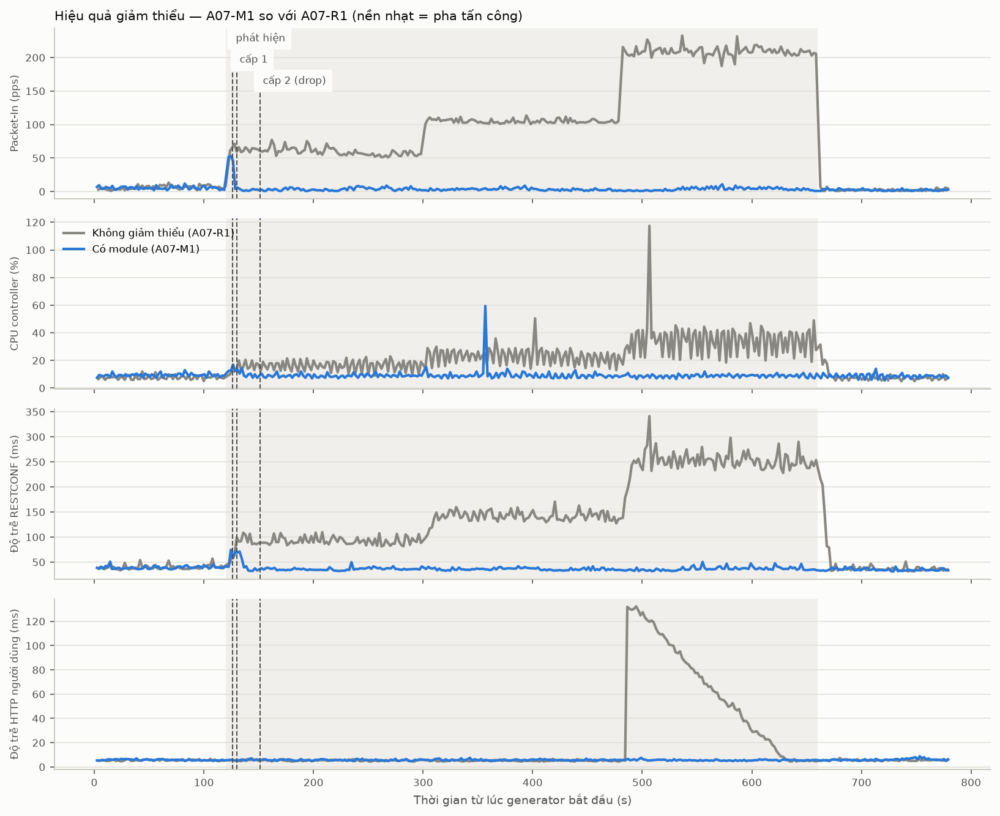

# Hiệu quả giảm thiểu — A07-M1 so với A07-R1

Sinh bởi `src/analyze_mitigation.py`. Cùng kịch bản A07, lưu lượng nền như nhau; A07-R1 chạy không có module, A07-M1 chạy có module thời gian thực.

## Dòng thời gian của module (tính từ lúc tấn công bắt đầu)

| Mốc | Giây sau khi tấn công bắt đầu |
|---|---|
| Nghi ngờ (cửa sổ đầu dương tính) | 2.3 |
| Xác nhận tấn công (k/n) | 6.4 |
| Cài rule cấp 1 xong (RESTCONF) | 9.9 |
| Rule cấp 1 nằm trên switch | 9.9 |
| Cài rule cấp 2 (drop) | 31.0 |

Rule cấp 1: RESTCONF 10.5 ms, lên switch sau 3.54 s.

## So sánh theo pha (trung bình)

| Pha | Chỉ số | Không giảm thiểu | Có module | Thay đổi |
|---|---|---|---|---|
| baseline | Packet-In (pps) | 6.21 | 5.59 | -10% |
| baseline | CPU controller (%) | 7.78 | 9.36 | +20% |
| baseline | Độ trễ RESTCONF (ms) | 40.05 | 39.26 | -2% |
| baseline | Độ trễ HTTP người dùng (ms) | 5.55 | 5.82 | +5% |
| baseline | HTTP thành công | 1.00 | 1.00 | +0% |
| P1 | Packet-In (pps) | 59.96 | 5.12 | -91% |
| P1 | CPU controller (%) | 16.13 | 9.32 | -42% |
| P1 | Độ trễ RESTCONF (ms) | 91.62 | 38.38 | -58% |
| P1 | Độ trễ HTTP người dùng (ms) | 5.38 | 5.70 | +6% |
| P1 | HTTP thành công | 1.00 | 1.00 | +0% |
| P2 | Packet-In (pps) | 105.05 | 3.29 | -97% |
| P2 | CPU controller (%) | 23.08 | 9.65 | -58% |
| P2 | Độ trễ RESTCONF (ms) | 141.10 | 36.19 | -74% |
| P2 | Độ trễ HTTP người dùng (ms) | 5.17 | 5.77 | +12% |
| P2 | HTTP thành công | 1.00 | 1.00 | +0% |
| P3 | Packet-In (pps) | 209.12 | 3.79 | -98% |
| P3 | CPU controller (%) | 34.49 | 8.84 | -74% |
| P3 | Độ trễ RESTCONF (ms) | 250.66 | 36.77 | -85% |
| P3 | Độ trễ HTTP người dùng (ms) | 58.93 | 5.60 | -90% |
| P3 | HTTP thành công | 1.00 | 1.00 | +0% |
| recovery | Packet-In (pps) | 2.52 | 2.35 | -7% |
| recovery | CPU controller (%) | 8.30 | 8.67 | +4% |
| recovery | Độ trễ RESTCONF (ms) | 45.67 | 35.01 | -23% |
| recovery | Độ trễ HTTP người dùng (ms) | 5.60 | 6.05 | +8% |
| recovery | HTTP thành công | 1.00 | 1.00 | +0% |

