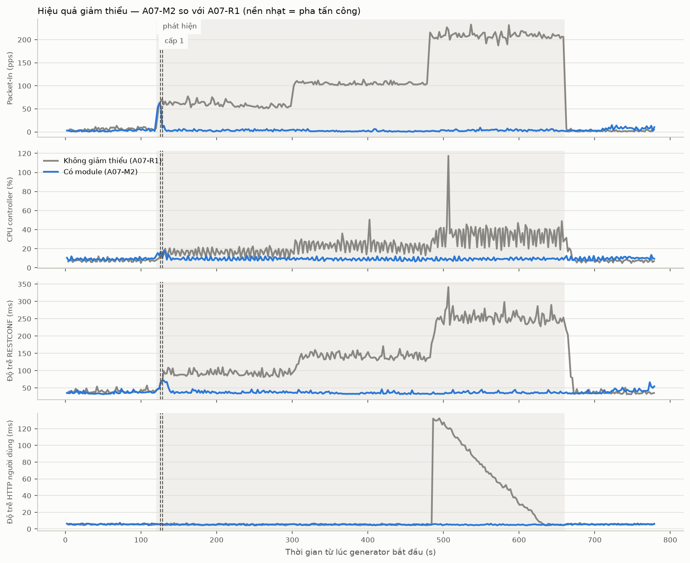

# Hiệu quả giảm thiểu — A07-M2 so với A07-R1

Sinh bởi `src/analyze_mitigation.py`. Cùng kịch bản A07, lưu lượng nền như nhau; A07-R1 chạy không có module, A07-M2 chạy có module thời gian thực.

## Dòng thời gian của module (tính từ lúc tấn công bắt đầu)

| Mốc | Giây sau khi tấn công bắt đầu |
|---|---|
| Nghi ngờ (cửa sổ đầu dương tính) | 2.0 |
| Xác nhận tấn công (k/n) | 6.0 |
| Cài rule cấp 1 xong (RESTCONF) | 8.5 |
| Rule cấp 1 nằm trên switch | 8.5 |

Rule cấp 1: RESTCONF 8.8 ms, lên switch sau 2.53 s.

## So sánh theo pha (trung bình)

| Pha | Chỉ số | Không giảm thiểu | Có module | Thay đổi |
|---|---|---|---|---|
| baseline | Packet-In (pps) | 6.21 | 2.81 | -55% |
| baseline | CPU controller (%) | 7.78 | 9.09 | +17% |
| baseline | Độ trễ RESTCONF (ms) | 40.05 | 36.51 | -9% |
| baseline | Độ trễ HTTP người dùng (ms) | 5.55 | 5.83 | +5% |
| baseline | HTTP thành công | 1.00 | 1.00 | +0% |
| P1 | Packet-In (pps) | 59.96 | 5.47 | -91% |
| P1 | CPU controller (%) | 16.13 | 9.84 | -39% |
| P1 | Độ trễ RESTCONF (ms) | 91.62 | 39.95 | -56% |
| P1 | Độ trễ HTTP người dùng (ms) | 5.38 | 5.43 | +1% |
| P1 | HTTP thành công | 1.00 | 1.00 | +0% |
| P2 | Packet-In (pps) | 105.05 | 2.01 | -98% |
| P2 | CPU controller (%) | 23.08 | 8.99 | -61% |
| P2 | Độ trễ RESTCONF (ms) | 141.10 | 35.53 | -75% |
| P2 | Độ trễ HTTP người dùng (ms) | 5.17 | 5.41 | +5% |
| P2 | HTTP thành công | 1.00 | 1.00 | +0% |
| P3 | Packet-In (pps) | 209.12 | 3.50 | -98% |
| P3 | CPU controller (%) | 34.49 | 9.15 | -73% |
| P3 | Độ trễ RESTCONF (ms) | 250.66 | 36.41 | -85% |
| P3 | Độ trễ HTTP người dùng (ms) | 58.93 | 5.15 | -91% |
| P3 | HTTP thành công | 1.00 | 1.00 | +0% |
| recovery | Packet-In (pps) | 2.52 | 6.03 | +139% |
| recovery | CPU controller (%) | 8.30 | 9.81 | +18% |
| recovery | Độ trễ RESTCONF (ms) | 45.67 | 40.35 | -12% |
| recovery | Độ trễ HTTP người dùng (ms) | 5.60 | 5.70 | +2% |
| recovery | HTTP thành công | 1.00 | 1.00 | +0% |

