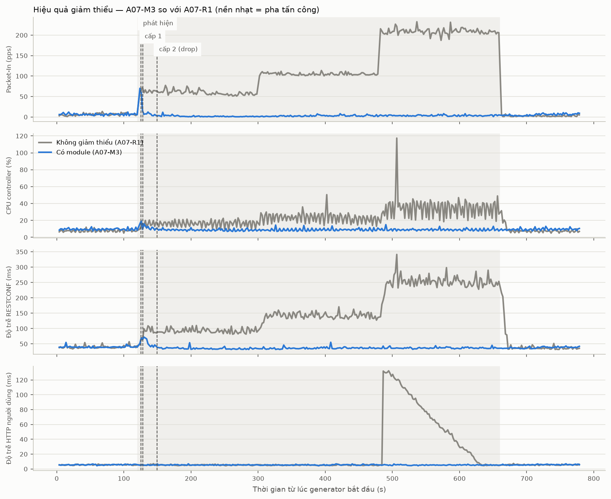

# Hiệu quả giảm thiểu — A07-M3 so với A07-R1

Sinh bởi `src/analyze_mitigation.py`. Cùng kịch bản A07, lưu lượng nền như nhau; A07-R1 chạy không có module, A07-M3 chạy có module thời gian thực.

## Dòng thời gian của module (tính từ lúc tấn công bắt đầu)

| Mốc | Giây sau khi tấn công bắt đầu |
|---|---|
| Nghi ngờ (cửa sổ đầu dương tính) | 1.7 |
| Xác nhận tấn công (k/n) | 5.8 |
| Cài rule cấp 1 xong (RESTCONF) | 8.3 |
| Rule cấp 1 nằm trên switch | 8.3 |
| Cài rule cấp 2 (drop) | 29.7 |

Rule cấp 1: RESTCONF 9.3 ms, lên switch sau 2.53 s.

## So sánh theo pha (trung bình)

| Pha | Chỉ số | Không giảm thiểu | Có module | Thay đổi |
|---|---|---|---|---|
| baseline | Packet-In (pps) | 6.21 | 6.39 | +3% |
| baseline | CPU controller (%) | 7.78 | 9.52 | +22% |
| baseline | Độ trễ RESTCONF (ms) | 40.05 | 39.79 | -1% |
| baseline | Độ trễ HTTP người dùng (ms) | 5.55 | 5.65 | +2% |
| baseline | HTTP thành công | 1.00 | 1.00 | +0% |
| P1 | Packet-In (pps) | 59.96 | 3.87 | -94% |
| P1 | CPU controller (%) | 16.13 | 9.20 | -43% |
| P1 | Độ trễ RESTCONF (ms) | 91.62 | 37.93 | -59% |
| P1 | Độ trễ HTTP người dùng (ms) | 5.38 | 5.39 | +0% |
| P1 | HTTP thành công | 1.00 | 1.00 | +0% |
| P2 | Packet-In (pps) | 105.05 | 2.74 | -97% |
| P2 | CPU controller (%) | 23.08 | 8.96 | -61% |
| P2 | Độ trễ RESTCONF (ms) | 141.10 | 36.11 | -74% |
| P2 | Độ trễ HTTP người dùng (ms) | 5.17 | 5.42 | +5% |
| P2 | HTTP thành công | 1.00 | 1.00 | +0% |
| P3 | Packet-In (pps) | 209.12 | 3.50 | -98% |
| P3 | CPU controller (%) | 34.49 | 9.05 | -74% |
| P3 | Độ trễ RESTCONF (ms) | 250.66 | 36.70 | -85% |
| P3 | Độ trễ HTTP người dùng (ms) | 58.93 | 5.28 | -91% |
| P3 | HTTP thành công | 1.00 | 1.00 | +0% |
| recovery | Packet-In (pps) | 2.52 | 5.49 | +118% |
| recovery | CPU controller (%) | 8.30 | 9.48 | +14% |
| recovery | Độ trễ RESTCONF (ms) | 45.67 | 37.84 | -17% |
| recovery | Độ trễ HTTP người dùng (ms) | 5.60 | 5.68 | +1% |
| recovery | HTTP thành công | 1.00 | 1.00 | +0% |

