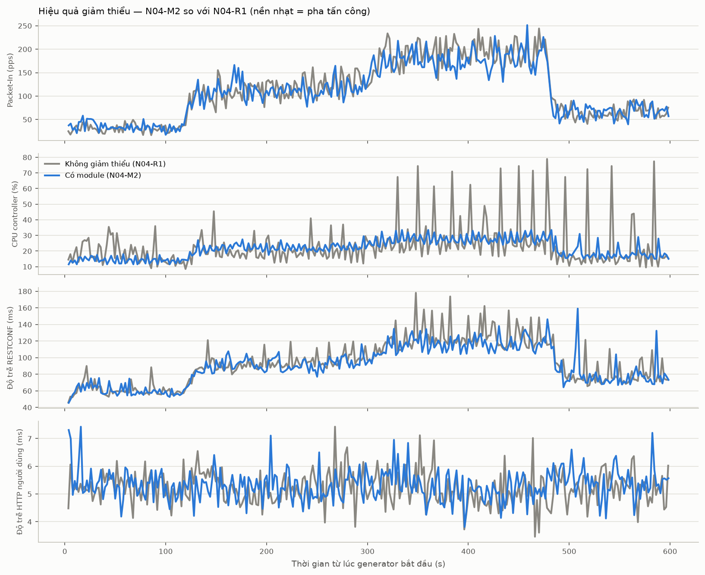

# Hiệu quả giảm thiểu — N04-M2 so với N04-R1

Sinh bởi `src/analyze_mitigation.py`. Cùng kịch bản N04, lưu lượng nền như nhau; N04-R1 chạy không có module, N04-M2 chạy có module thời gian thực.

## Dòng thời gian của module (tính từ lúc tấn công bắt đầu)

| Mốc | Giây sau khi tấn công bắt đầu |
|---|---|

## So sánh theo pha (trung bình)

| Pha | Chỉ số | Không giảm thiểu | Có module | Thay đổi |
|---|---|---|---|---|
| warmup | Packet-In (pps) | 31.16 | 34.55 | +11% |
| warmup | CPU controller (%) | 18.08 | 14.12 | -22% |
| warmup | Độ trễ RESTCONF (ms) | 60.93 | 59.93 | -2% |
| warmup | Độ trễ HTTP người dùng (ms) | 5.26 | 5.39 | +2% |
| warmup | HTTP thành công | 1.00 | 1.00 | +0% |
| surge1 | Packet-In (pps) | 115.98 | 111.67 | -4% |
| surge1 | CPU controller (%) | 20.60 | 21.91 | +6% |
| surge1 | Độ trễ RESTCONF (ms) | 93.77 | 90.83 | -3% |
| surge1 | Độ trễ HTTP người dùng (ms) | 5.29 | 5.27 | -0% |
| surge1 | HTTP thành công | 1.00 | 1.00 | +0% |
| surge2 | Packet-In (pps) | 191.47 | 177.62 | -7% |
| surge2 | CPU controller (%) | 29.70 | 27.72 | -7% |
| surge2 | Độ trễ RESTCONF (ms) | 124.18 | 116.05 | -7% |
| surge2 | Độ trễ HTTP người dùng (ms) | 5.13 | 5.22 | +2% |
| surge2 | HTTP thành công | 1.00 | 1.00 | +0% |
| cooldown | Packet-In (pps) | 66.73 | 67.41 | +1% |
| cooldown | CPU controller (%) | 20.26 | 18.66 | -8% |
| cooldown | Độ trễ RESTCONF (ms) | 80.99 | 80.06 | -1% |
| cooldown | Độ trễ HTTP người dùng (ms) | 5.25 | 5.47 | +4% |
| cooldown | HTTP thành công | 1.00 | 1.00 | +0% |

