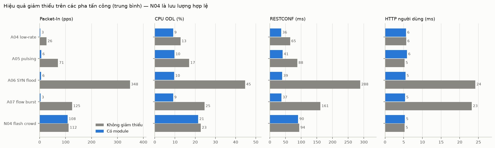

# Tổng hợp hiệu quả giảm thiểu thời gian thực (chương 4.4)

Sinh bởi `src/summarize_mitigation.py`. Mỗi kịch bản: một lần chạy KHÔNG có module (R1) và một lần CÓ module (M), cùng generator, cùng lưu lượng nền. Chỉ số = trung bình trên các **pha tấn công** (N04: toàn bộ lần chạy). Module chạy `--mode mitigate --allow-drop`.

## 1. Sức khỏe controller và dịch vụ

| Kịch bản | Packet-In (pps) | CPU ODL (%) | RESTCONF (ms) | HTTP người dùng (ms) | HTTP thành công |
|---|---|---|---|---|---|
| A04 low-rate | 26.0 → 2.5 (-90%) | 12.7 → 9.1 (-29%) | 64.5 → 36.1 (-44%) | 5.7 → 5.6 (-1%) | 1.00 → 1.00 |
| A05 pulsing | 70.7 → 6.2 (-91%) | 17.0 → 9.7 (-43%) | 87.5 → 40.6 (-54%) | 5.2 → 5.9 (+13%) | 1.00 → 1.00 |
| A06 SYN flood | 348.1 → 5.7 (-98%) | 44.7 → 9.6 (-79%) | 288.4 → 39.0 (-86%) | 24.2 → 5.5 (-77%) | 1.00 → 1.00 |
| A07 flow burst | 125.0 → 3.4 (-97%) | 24.6 → 9.1 (-63%) | 161.4 → 36.9 (-77%) | 23.2 → 5.4 (-77%) | 1.00 → 1.00 |
| N04 flash crowd | 111.7 → 107.6 (-4%) | 22.7 → 21.5 (-6%) | 93.7 → 90.2 (-4%) | 5.2 → 5.3 (+2%) | 1.00 → 1.00 |

## 2. Dòng thời gian module và an toàn

| Kịch bản | Lần chạy | Phát hiện (s) | Cấp 1 trên switch (s) | Cấp 2 (s) | Số lần cài cấp 1 | Giữ rule (hold) | Rule nhắm người dùng | Drop người dùng | Ghi chú |
|---|---|---|---|---|---|---|---|---|---|
| A04 low-rate | A04-M4 | 14.7 | 16.7 | 167.4 | 2 | 20 | 1 | 0 | sau 3 vòng sửa quy kết (A04-M1..M3) |
| A05 pulsing | A05-M2 | 8.1 | 10.7 | 55.9 | 1 | 0 | 0 | 0 |  |
| A06 SYN flood | A06-M3 | 5.8 | 9.4 | 30.6 | 2 | 0 | 1 | 0 | sau sửa quy kết bổ sung (A06-M2) |
| A07 flow burst | A07-M3 | 5.8 | 8.3 | 29.7 | 2 | 0 | 1 | 0 | sau sửa quy kết bổ sung (A07-M2) |
| N04 flash crowd | N04-M2 | — | — | — | 0 | 0 | 0 | 0 | lưu lượng hợp lệ: mong đợi KHÔNG can thiệp |

Thời gian tính từ lúc pha tấn công đầu tiên bắt đầu. *Rule nhắm người dùng* = rule cấp 1 (chuyển tiếp thẳng, không cắt dịch vụ) đặt lên nguồn hợp lệ do quy kết bổ sung; *Drop người dùng* phải luôn bằng 0.

## 3. Quá trình hoàn thiện module (lỗi thấy khi chạy thật → sửa → kiểm thử hồi quy)

| Lần chạy | Vấn đề quan sát | Sửa |
|---|---|---|
| A04-M1 | Quy kết theo 1 mẫu 2 s → nhắm & drop người dùng .11, HTTP thành công 0% | Mức nền Packet-In mỗi nguồn, bằng chứng 10 s, kiểm định ≥ 2× và > 4σ Poisson; nguồn bổ sung chỉ cấp 1 |
| A04-M2 | HTTP 100% nhưng mức nền máy tấn công học sai (5,0) → nhắm .11 trước; gỡ/cài lại ~1 phút/lần | Mức nền cho mọi máy (im lặng = 0); đọc bộ đếm gói của rule trước khi gỡ (hold) |
| A04-M3 | Nhắm đúng ngay; hold hoạt động nhưng đo hỏng khi rule cấp 1 bị idle-timeout | Đo bộ đếm theo từng rule |
| A04-M4 | Cấp 1 cài một lần; Packet-In −78…−95%; nguồn phụ hợp lệ bị giữ rule tới hết | Phản hồi bộ đếm chỉ cho nguồn chính; nguồn phụ gỡ theo mô hình (`test_engine.py`) |
| A06/A07-M2 | Packet-In người dùng tăng nhẹ do chính tấn công → nhắm bổ sung .11 → .13 bị nghi nhắm sai, không lên cấp 2; SYN flood chỉ giảm −66% (SYN-ACK trả về vẫn sinh Packet-In ở leaf phía web) | Quy kết bổ sung sau khi cửa sổ bằng chứng nằm trọn sau rule; chỉ nghi nhắm sai khi nguồn mới vượt nền ≥ bằng chứng nguồn cũ |
